# Прецеденты ИС «Караваны» — полные описания и диаграммы

Документ содержит полные сценарии всех **34 прецедентов UC-1…UC-34** из [UseCases.md](UseCases.md).
Все общие, тематические и подробные диаграммы собраны в [каталоге диаграмм](diagrams/usecases/README.md).
Архитектурно значимые UC-1, UC-7, UC-16, UC-19 и UC-32 сохранены и отмечены в перечне.
Остальные сценарии детализированы по [SRS.md](SRS.md), [Vision.md](Vision.md) и
[глоссарию](Glossary_Karavany_FNV.md). Описание задаёт целевое поведение продукта и не означает,
что все перечисленные функции уже реализованы.

Для каждого прецедента приведены основной и альтернативные потоки, постусловия, диаграмма
прецедента и диаграмма активности. Оба вида диаграмм доступны в PlantUML и в родном XML
Visual Paradigm. Связи `include` направлены от включающего к включаемому прецеденту, `extend` —
от расширяющего к базовому. Переход между экранами и предварительный вход в систему сами по себе
не создают связей `include` или `extend`.

Общие условия: пользователи действуют в пределах своей организации и полномочий; полный
административный доступ суперпользователя регулируется FR-25. В полевых сценариях отсутствие
связи означает локальное сохранение с ожидающей синхронизацией, а не уже подтверждённое изменение
на сервере. Постусловия относятся к успешному завершению; результат отмены, отказа или локального
сохранения явно указан в соответствующей альтернативе. Сохранение аудита оценивается отдельно
от доступности основных операций. При повторной передаче сначала проверяется идентификатор ранее
принятого события; для дубликата возвращается прежний результат до повторной проверки порядка
этапов и статуса, которые могли измениться после первой обработки.

Номер альтернативы обозначает шаг основного потока, в котором возникает ответвление; после
стрелки указан возврат, продолжение или конечный результат. В диаграммах активности сохранены
все перечисленные основные шаги и альтернативы. UC-14, UC-17 и UC-18 уточняют обработку того же
события UC-16: общие действия фиксации, проверки и сохранения выполняются один раз, а описания
расширений раскрывают их для соответствующего вида события; второе независимое событие не создаётся.

| ID | Прецедент | Архитектурный аспект |
| --- | --- | --- |
| UC-1 | [Создать заявку на перевозку](#uc-1-создать-заявку-на-перевозку) | Ядро заявки и взаимодействие с планированием и риском |
| UC-2 | [Управлять статусами заявки](#uc-2-управлять-статусами-заявки) | — |
| UC-3 | [Просмотреть реестр рейсов](#uc-3-просмотреть-реестр-рейсов) | — |
| UC-4 | [Поиск и фильтрация завершённых рейсов](#uc-4-поиск-и-фильтрация-завершённых-рейсов) | — |
| UC-5 | [Выбрать/спланировать маршрут](#uc-5-выбратьспланировать-маршрут) | — |
| UC-6 | [Рассчитать ETA](#uc-6-рассчитать-eta) | — |
| UC-7 | [Рассчитать risk_score](#uc-7-рассчитать-risk_score) | Внешние данные, актуальность и обработка отказов |
| UC-8 | [Получить рекомендацию по охране и припасам](#uc-8-получить-рекомендацию-по-охране-и-припасам) | — |
| UC-9 | [Назначить сотрудников на роли рейса](#uc-9-назначить-сотрудников-на-роли-рейса) | — |
| UC-10 | [Просмотреть доступных сотрудников](#uc-10-просмотреть-доступных-сотрудников) | — |
| UC-11 | [Создать груз-манифест](#uc-11-создать-груз-манифест) | — |
| UC-12 | [Указать ценность груза](#uc-12-указать-ценность-груза) | — |
| UC-13 | [Зарезервировать припасы](#uc-13-зарезервировать-припасы) | — |
| UC-14 | [Подтвердить доставку груза (с пломбой)](#uc-14-подтвердить-доставку-груза-с-пломбой) | — |
| UC-15 | [Выполнить сверку манифеста при приёмке](#uc-15-выполнить-сверку-манифеста-при-приёмке) | — |
| UC-16 | [Зафиксировать прохождение этапа рейса](#uc-16-зафиксировать-прохождение-этапа-рейса) | Офлайн-события и согласование статусов |
| UC-17 | [Отметить прохождение контрольной точки](#uc-17-отметить-прохождение-контрольной-точки) | — |
| UC-18 | [Отметить прохождение КПП (с пошлиной)](#uc-18-отметить-прохождение-кпп-с-пошлиной) | — |
| UC-19 | [Сообщить об инциденте в рейсе](#uc-19-сообщить-об-инциденте-в-рейсе) | Офлайн-инциденты, уведомление и реагирование |
| UC-20 | [Инициировать RecoveryRequest](#uc-20-инициировать-recoveryrequest) | — |
| UC-21 | [Сформировать финансовый отчёт по рейсу](#uc-21-сформировать-финансовый-отчёт-по-рейсу) | — |
| UC-22 | [Экспортировать отчёт на голотейп](#uc-22-экспортировать-отчёт-на-голотейп) | — |
| UC-23 | [Получить данные об угрозах](#uc-23-получить-данные-об-угрозах) | — |
| UC-24 | [Получить данные о КПП и пошлинах](#uc-24-получить-данные-о-кпп-и-пошлинах) | — |
| UC-25 | [Аутентификация](#uc-25-аутентификация) | — |
| UC-26 | [Создать учётную запись пользователя](#uc-26-создать-учётную-запись-пользователя) | — |
| UC-27 | [Изменить роль пользователя](#uc-27-изменить-роль-пользователя) | — |
| UC-28 | [Деактивировать учётную запись](#uc-28-деактивировать-учётную-запись) | — |
| UC-29 | [Редактировать свои учётные данные](#uc-29-редактировать-свои-учётные-данные) | — |
| UC-30 | [Сбросить учётные данные пользователя](#uc-30-сбросить-учётные-данные-пользователя) | — |
| UC-31 | [Назначить/изменить ставку сотрудника](#uc-31-назначитьизменить-ставку-сотрудника) | — |
| UC-32 | [Создать организацию](#uc-32-создать-организацию) | Организации, изоляция данных и первоначальное администрирование |
| UC-33 | [Назначить первого диспетчера организации](#uc-33-назначить-первого-диспетчера-организации) | — |
| UC-34 | [Управлять подписками](#uc-34-управлять-подписками) | — |

---

## UC-1. Создать заявку на перевозку

| Прецедент: Создать заявку на перевозку |
| :--- |
| **ID:** UC-1 |
| **Краткое описание:** Диспетчер создаёт новую заявку на перевозку, выбирая шаблон маршрута или заполняя данные вручную. |
| **Главные актёры:** Диспетчер караванов |
| **Второстепенные актёры:** Wasteland Intel (для расчёта risk_score) |
| **Предусловия:**  1. Диспетчер аутентифицирован и действует в рамках своей организации. 2. Создаётся новая заявка; доступен шаблон маршрута либо данные для ручного планирования. |
| **Основной поток:**  1. Диспетчер открывает форму создания заявки. 2. Диспетчер вводит пункты отправления и назначения, дату отправки и описание груза. 3. Диспетчер указывает оценочную ценность груза в крышках (UC-12). 4. Диспетчер выбирает шаблон или формирует маршрут через UC-5. 5. Система получает данные об угрозах и рассчитывает risk_score с учётом ценности груза (UC-7). 6. Система рассчитывает ETA по выбранному маршруту (UC-6). 7. Система показывает результат UC-8: при рассчитанном риске — рекомендацию по охране и припасам, уже полученную в UC-7; при «Н/Д» — отсутствие достоверной рекомендации. 8. Диспетчер проверяет сводку и подтверждает создание; система проверяет обязательные поля. 9. Система сохраняет заявку со статусом Draft, начальную запись истории и событие создания в журнале аудита. |
| **Альтернативные потоки:**  4а. Вместо шаблона диспетчер задаёт контрольные точки вручную; UC-5 проверяет маршрут → переход к шагу 5. 5а. Wasteland Intel недоступен или ответ непригоден — UC-7 возвращает «Н/Д, требует пересчёта»; достоверная рекомендация по риску не формируется → переход к шагу 6. 5б. Данные об угрозах старше 24 часов — риск рассчитывается с пометкой об устаревших данных → переход к шагу 6. 8а. Диспетчер отменяет создание → завершение без сохранения заявки. 8б. Обязательные поля заполнены неверно — система показывает ошибки → возврат к шагу 2. |
| **Постусловия:**  1. В организации создана заявка со статусом Draft, маршрутом, ценностью груза и ETA. 2. Риск и рекомендация сохранены вместе с признаком актуальности; при недоступном источнике явно показано, что риск требует пересчёта. 3. Создание заявки отражено в истории и аудите. |
| **Включаемые прецеденты:** UC-5, UC-6, UC-7, UC-8, UC-12. |

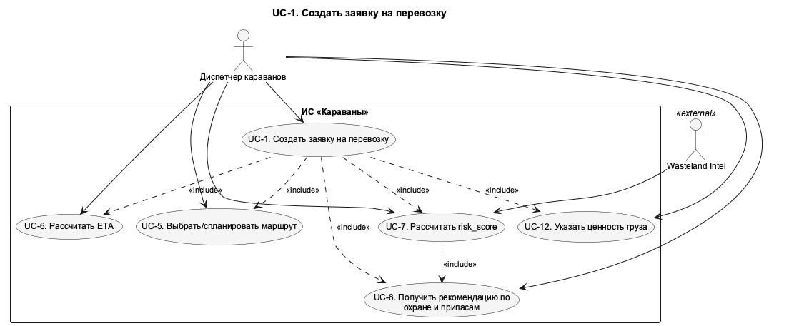

[PlantUML — прецедент](diagrams/usecases/UC_1_Detail.puml) · [Visual Paradigm XML — прецедент](diagrams/vp/out/usecases/UC_1_Detail.xml)

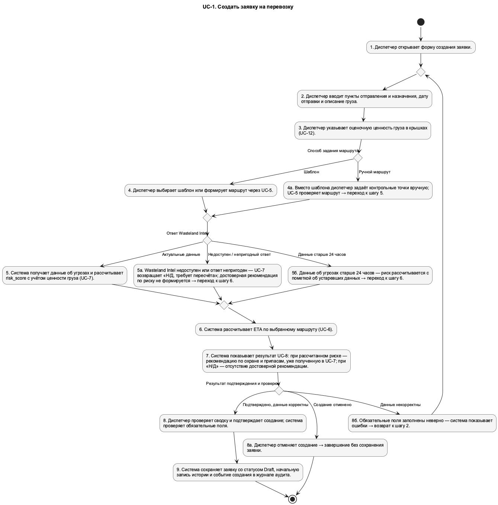

[PlantUML — активность](diagrams/usecases/UC_1_Activity.puml) · [Visual Paradigm XML — активность](diagrams/vp/out/usecases/UC_1_Activity.xml)

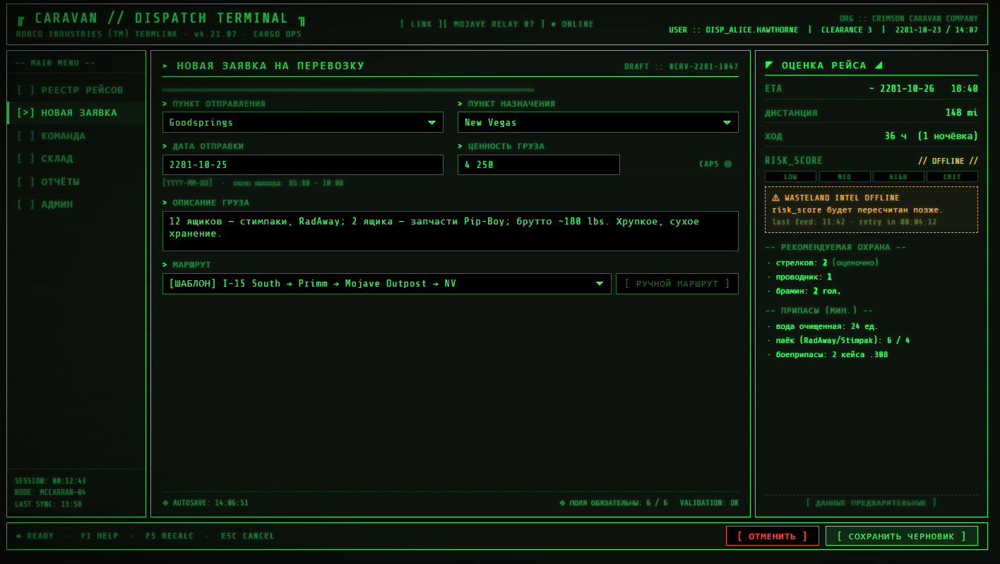

[Исходник макета](mockups/uc1_create_request.html)

---

## UC-2. Управлять статусами заявки

| Прецедент: Управлять статусами заявки |
| :--- |
| **ID:** UC-2 |
| **Краткое описание:** Система поддерживает статусную модель заявки (Draft, Ready, En Route, Delayed, Delivered, Closed, Cancelled), переходы инициируются пользователями или событиями. |
| **Главные актёры:** Диспетчер караванов, Караван-мастер |
| **Второстепенные актёры:** Нет |
| **Предусловия:**  1. Ручной переход инициирует аутентифицированный пользователь своей организации; автоматический переход запускается зарегистрированным событием этой организации. 2. Заявка существует; текущий статус доступен для просмотра. Возможность перехода проверяется в ходе сценария. |
| **Основной поток:**  1. Пользователь открывает карточку заявки и видит её текущий статус. 2. Система показывает переходы, доступные из текущего статуса, с указанием ролей, которым они разрешены. 3. Пользователь выбирает переход (например, «Караван вышел на маршрут») и при необходимости указывает причину. 4. Система проверяет допустимость перехода по статусной модели. 5. Система проверяет права роли пользователя на этот переход. 6. Система проверяет обязательную причину и готовность данных для целевого статуса (FR-10: перевод в «В пути» блокируется при незаполненных обязательных ролях команды). 7. Система изменяет статус заявки. 8. Система добавляет запись в историю изменений статуса: исходный и целевой статус, роль и имя актора, причина, отметка времени. 9. Система записывает событие изменения статуса в журнал аудита. |
| **Альтернативные потоки:**  2а. Заявка в финальном статусе Closed или Cancelled — система показывает историю без переходов → завершение без изменения статуса. 4а. Переход не предусмотрен моделью — система сообщает допустимые действия → возврат к шагу 2. 5а. Роль не имеет права выполнить переход — система отклоняет действие → возврат к шагу 2. 6а. Не заполнены обязательные роли или другие предусмотренные для целевого статуса данные — система перечисляет причины → возврат к шагу 2. 6б. Для задержки не указана обязательная причина — система запрашивает её → возврат к шагу 3. 7а. Переход инициирован зарегистрированным событием UC-19, а не человеком; система выполняет проверки шагов 4–6, изменяет статус и задаёт актора «Система» → переход к шагу 8. |
| **Постусловия:**  1. Заявка находится в новом статусе. 2. В истории изменений статуса зафиксирован переход с автором, временем и причиной. 3. В журнале аудита зафиксировано событие изменения статуса. |

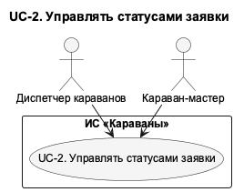

[PlantUML — прецедент](diagrams/usecases/UC_2_Detail.puml) · [Visual Paradigm XML — прецедент](diagrams/vp/out/usecases/UC_2_Detail.xml)

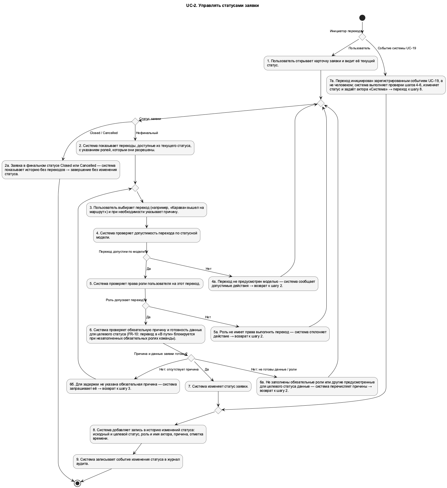

[PlantUML — активность](diagrams/usecases/UC_2_Activity.puml) · [Visual Paradigm XML — активность](diagrams/vp/out/usecases/UC_2_Activity.xml)

---

## UC-3. Просмотреть реестр рейсов

| Прецедент: Просмотреть реестр рейсов |
| :--- |
| **ID:** UC-3 |
| **Краткое описание:** Диспетчер просматривает дашборд активных рейсов с цветовой индикацией статуса и risk_score. |
| **Главные актёры:** Диспетчер караванов |
| **Второстепенные актёры:** Нет |
| **Предусловия:**  1. Диспетчер аутентифицирован и действует в рамках своей организации. 2. Разрешён просмотр реестра организации; отсутствие заявок допускается. |
| **Основной поток:**  1. Диспетчер открывает реестр рейсов. 2. Система определяет организацию диспетчера и отбирает рейсы только этой организации. 3. Система показывает срез активных рейсов: маршрут, пункты отправления и назначения, дата отправки, описание и ценность груза, ETA, статус, risk_score с рекомендацией, последнее изменение статуса. 4. Система отмечает статус цветным бейджем, а risk_score — цветным уровнем риска; цвет всегда сопровождается текстовой подписью. 5. Система выделяет рейсы, требующие внимания, и указывает причину. 6. Система показывает сводку по срезу: число рейсов, распределение по статусам, распределение по уровням риска и число рейсов, требующих внимания. 7. Диспетчер отбирает рейсы фильтрами (статус, уровень риска, только требующие внимания) и выбирает порядок сортировки. 8. Система применяет отбор и сортировку, сохраняя ограничение организацией; сводка при этом не меняется. 9. Диспетчер переключается на срез завершённых рейсов или открывает карточку рейса, откуда доступны управление статусом и история переходов (UC-2) и разбор расчёта risk_score (UC-7). |
| **Альтернативные потоки:**  1а. Организация не выбрана — система показывает доступные организации и не раскрывает рейсы до выбора разрешённого контекста → возврат к шагу 1 после выбора организации. 3а. В организации нет заявок — система показывает пустой реестр с предложением создать заявку через UC-1 → завершение просмотра пустого реестра. 3б. Сервер недоступен — система сообщает об ошибке и не показывает частичных данных; диспетчер повторяет загрузку → возврат к шагу 1. 5а. risk_score не рассчитан (UC-7, альт. 2а) — значение показано как «Н/Д» нейтральным цветом с пометкой «требует пересчёта»; диспетчер при необходимости запускает UC-7 → переход к шагу 6 после показа результата либо причины недоступности. 5б. risk_score рассчитан по данным старше 24 часов (UC-7, альт. 2б) — уровень риска сохраняется с пометкой об устаревших данных → переход к шагу 6. 8а. Под фильтры не подошёл ни один рейс — система показывает пустой результат, сводка по срезу сохраняется; диспетчер меняет либо сбрасывает фильтры → возврат к шагу 7. 9а. Рейс находится в финальном статусе — карточка открывается только для просмотра, переходов нет (UC-2, альт. 2а) → завершение просмотра карточки. 9б. Нужен разбор истории завершённых рейсов — реестр переключается на архивный срез; дальнейшие поиск и фильтрация выполняются в UC-4 (FR-4) → завершение просмотра активного среза. |
| **Постусловия:**  1. Диспетчеру показан реестр рейсов его организации; рейсы других организаций не показаны ни при каких фильтрах. 2. Активные и завершённые рейсы разделены на срезы, по умолчанию открыт срез активных. 3. У каждого рейса есть цветовая индикация статуса и уровня риска с текстовой подписью, включая «Н/Д» и пометку об устаревших данных. 4. Отбор и сортировка применены; данные системы запросом реестра не изменены. |

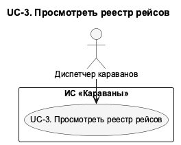

[PlantUML — прецедент](diagrams/usecases/UC_3_Detail.puml) · [Visual Paradigm XML — прецедент](diagrams/vp/out/usecases/UC_3_Detail.xml)

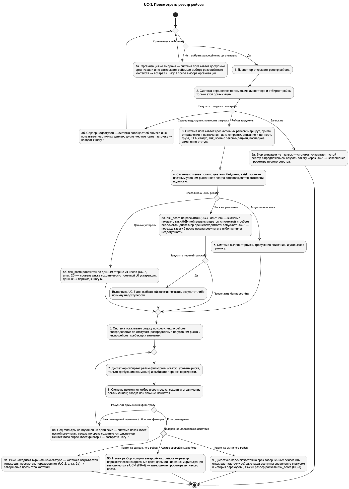

[PlantUML — активность](diagrams/usecases/UC_3_Activity.puml) · [Visual Paradigm XML — активность](diagrams/vp/out/usecases/UC_3_Activity.xml)

---

## UC-4. Поиск и фильтрация завершённых рейсов

| Прецедент: Поиск и фильтрация завершённых рейсов |
| :--- |
| **ID:** UC-4 |
| **Краткое описание:** Диспетчер выполняет поиск и фильтрацию по истории завершённых рейсов. |
| **Главные актёры:** Диспетчер караванов |
| **Второстепенные актёры:** Нет |
| **Предусловия:**  1. Диспетчер аутентифицирован и действует в рамках своей организации. |
| **Основной поток:**  1. Диспетчер открывает архив завершённых рейсов. 2. Система определяет организацию и отображает доступную ей историю завершённых рейсов. 3. Диспетчер задаёт поисковые условия и фильтры по доступным полям архива. 4. Система проверяет условия, выполняет поиск только в выбранном архивном срезе организации и показывает результат. 5. Диспетчер открывает найденный рейс и просматривает сведения, историю и связанные документы. |
| **Альтернативные потоки:**  2а. Архив пуст — система показывает пустое состояние → завершение без изменения данных. 4а. Условия некорректны — система поясняет ошибку → возврат к шагу 3. 4б. Совпадений нет — система показывает пустой результат и предлагает изменить условия → возврат к шагу 3. 5а. Рейс недоступен или не принадлежит организации — система не раскрывает данные → завершение без изменения данных. |
| **Постусловия:**  1. Показаны завершённые рейсы только своей организации с учётом заданных условий. 2. Данные рейсов поиском не изменены. |

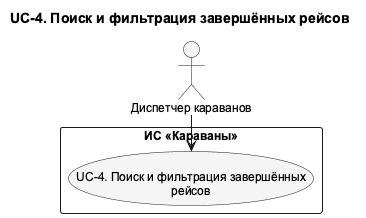

[PlantUML — прецедент](diagrams/usecases/UC_4_Detail.puml) · [Visual Paradigm XML — прецедент](diagrams/vp/out/usecases/UC_4_Detail.xml)

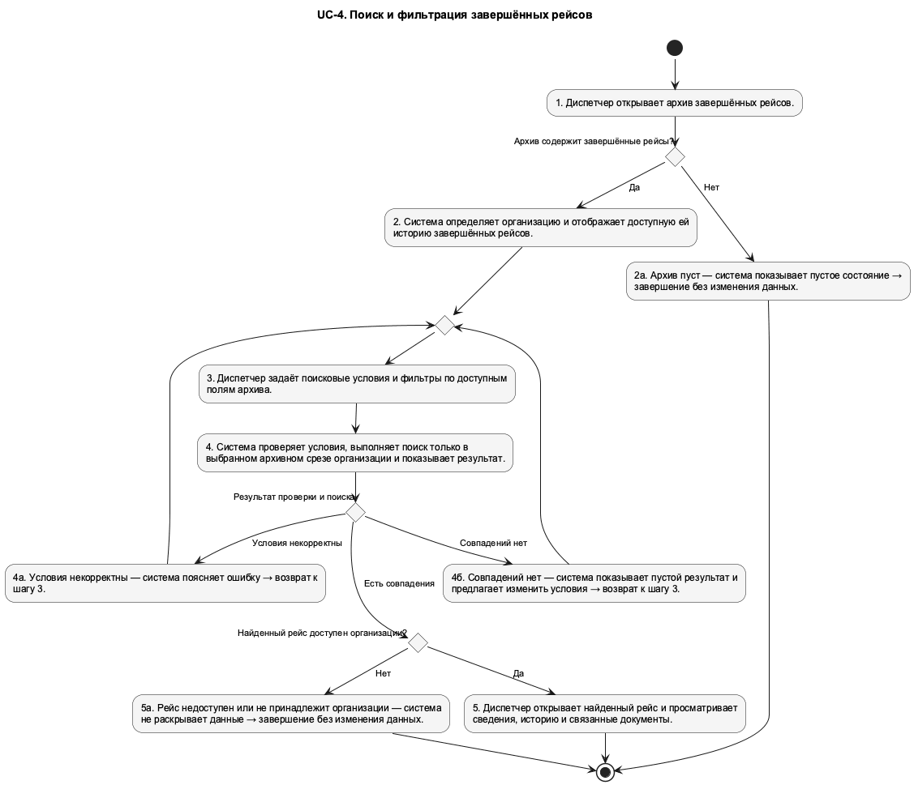

[PlantUML — активность](diagrams/usecases/UC_4_Activity.puml) · [Visual Paradigm XML — активность](diagrams/vp/out/usecases/UC_4_Activity.xml)

---

## UC-5. Выбрать/спланировать маршрут

| Прецедент: Выбрать/спланировать маршрут |
| :--- |
| **ID:** UC-5 |
| **Краткое описание:** Диспетчер выбирает маршрут из шаблонов или формирует вручную с учётом контрольных точек и данных об обстановке. |
| **Главные актёры:** Диспетчер караванов |
| **Второстепенные актёры:** Нет |
| **Предусловия:**  1. Диспетчер аутентифицирован и действует в рамках своей организации. 2. Открыта создаваемая либо редактируемая заявка с указанными пунктами отправления и назначения. |
| **Основной поток:**  1. Диспетчер открывает выбор маршрута заявки. 2. Система показывает доступные шаблоны и контрольные точки. 3. Диспетчер выбирает шаблон и просматривает последовательность участков. 4. Система проверяет наличие точек и связность выбранных участков маршрута. 5. Диспетчер подтверждает маршрут. 6. Система связывает маршрут с данными заявки; дальнейшие расчёты выполняются вызывающим сценарием. |
| **Альтернативные потоки:**  3а. Подходящего шаблона нет либо выбран ручной режим — диспетчер задаёт последовательность контрольных точек и участков → переход к шагу 4. 4а. Маршрут неполон или участки не связаны — система указывает ошибку → возврат к шагу 3. 5а. Диспетчер отменяет выбор → завершение с прежним маршрутом либо без маршрута у новой заявки. |
| **Постусловия:**  1. Для заявки определён маршрут с упорядоченными участками. 2. Маршрут готов для расчётов ETA и risk_score. |

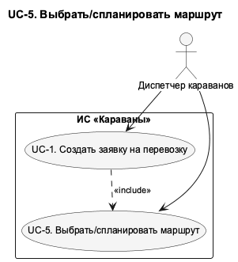

[PlantUML — прецедент](diagrams/usecases/UC_5_Detail.puml) · [Visual Paradigm XML — прецедент](diagrams/vp/out/usecases/UC_5_Detail.xml)

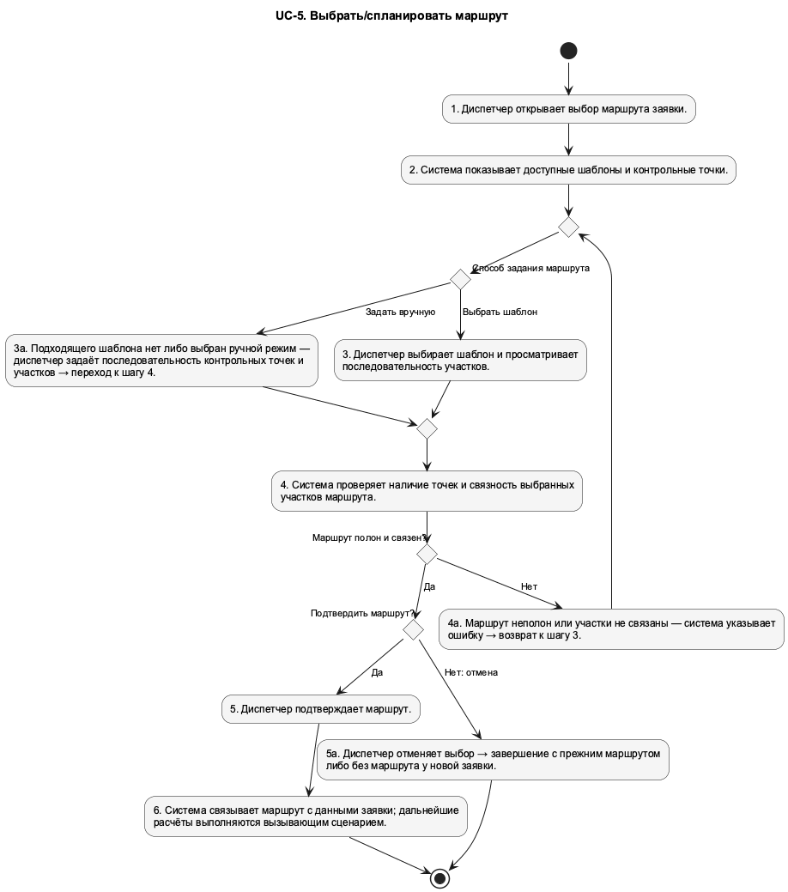

[PlantUML — активность](diagrams/usecases/UC_5_Activity.puml) · [Visual Paradigm XML — активность](diagrams/vp/out/usecases/UC_5_Activity.xml)

---

## UC-6. Рассчитать ETA

| Прецедент: Рассчитать ETA |
| :--- |
| **ID:** UC-6 |
| **Краткое описание:** Система автоматически рассчитывает ожидаемое время прибытия на основе выбранного маршрута и текущих данных об обстановке. |
| **Главные актёры:** Диспетчер караванов |
| **Второстепенные актёры:** Нет |
| **Предусловия:**  1. Диспетчер аутентифицирован и действует в рамках своей организации. 2. Для заявки выбран корректный маршрут и заданы исходные данные, необходимые для расчёта времени. |
| **Основной поток:**  1. Система получает выбранный маршрут и исходное время отправления. 2. Система определяет протяжённость участков и доступные данные об обстановке, влияющие на движение. 3. Система рассчитывает время прохождения участков по принятой модели расчёта. 4. Система суммирует время и определяет ожидаемое время прибытия. 5. Система сохраняет ETA в данных заявки и показывает результат диспетчеру. |
| **Альтернативные потоки:**  1а. Маршрут не определён — система сообщает о необходимости выбрать маршрут → завершение без расчёта. 2а. Часть данных об обстановке недоступна — система использует доступные данные и явно отмечает допущения → переход к шагу 3. 3а. Исходные данные не позволяют выполнить расчёт — система показывает причину → завершение без сохранения нового ETA. |
| **Постусловия:**  1. ETA соответствует выбранному маршруту и использованным исходным данным. 2. Допущения и недоступность влияющих данных явно обозначены. |

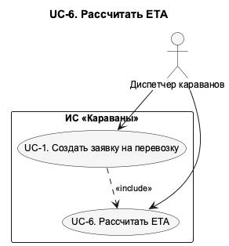

[PlantUML — прецедент](diagrams/usecases/UC_6_Detail.puml) · [Visual Paradigm XML — прецедент](diagrams/vp/out/usecases/UC_6_Detail.xml)

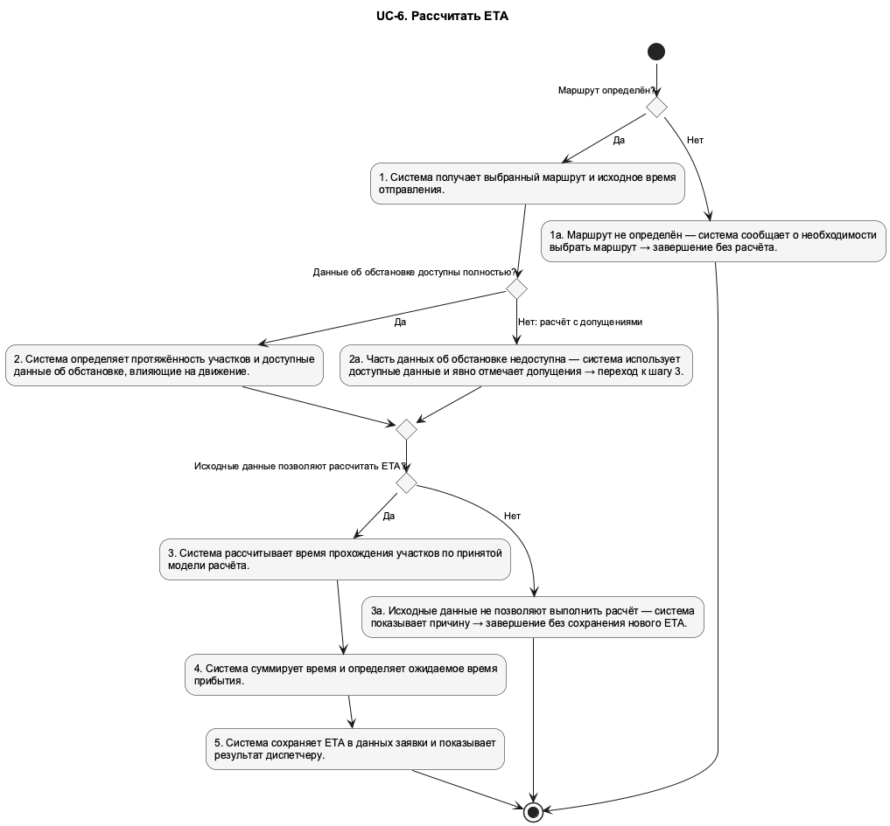

[PlantUML — активность](diagrams/usecases/UC_6_Activity.puml) · [Visual Paradigm XML — активность](diagrams/vp/out/usecases/UC_6_Activity.xml)

---

## UC-7. Рассчитать risk_score

| Прецедент: Рассчитать risk_score |
| :--- |
| **ID:** UC-7 |
| **Краткое описание:** Система автоматически рассчитывает оценку риска маршрута на основе данных Wasteland Intel и ценности груза. |
| **Главные актёры:** Диспетчер караванов |
| **Второстепенные актёры:** Wasteland Intel |
| **Предусловия:**  1. Для заявки выбран или сформирован маршрут (UC-5). 2. Указана ценность груза (или используется значение по умолчанию). |
| **Основной поток:**  1. Система получает данные об угрозах через UC-23, передавая участки выбранного маршрута. 2. Wasteland Intel возвращает данные об угрозах по каждому участку маршрута (тип угрозы, уровень опасности, дата актуальности). 3. Система агрегирует данные об угрозах и вычисляет базовый risk_score маршрута. 4. Система применяет корректирующий коэффициент ценности груза: чем выше ценность, тем выше итоговый risk_score. 5. Система сохраняет итоговый risk_score в заявке и отображает его диспетчеру. 6. На основе risk_score система автоматически формирует рекомендацию по минимальному составу охраны и объёму припасов (UC-8). |
| **Альтернативные потоки:**  2а. Wasteland Intel недоступен, возвращает ошибку или непригодный ответ — система устанавливает «Н/Д, требует пересчёта» и уведомляет диспетчера → завершение без вычисления достоверной рекомендации. 2б. Данные старше 24 часов — система предупреждает об устаревании и сохраняет этот признак → переход к шагу 3. |
| **Постусловия:**  1. В заявке сохранён risk_score с признаком актуальности либо состояние «Н/Д, требует пересчёта». 2. Если расчёт выполнен, сформирована рекомендация UC-8; устаревшие данные явно отмечены. |
| **Включаемые прецеденты:** UC-23 «Получить данные об угрозах»; UC-8 «Получить рекомендацию по охране и припасам». |

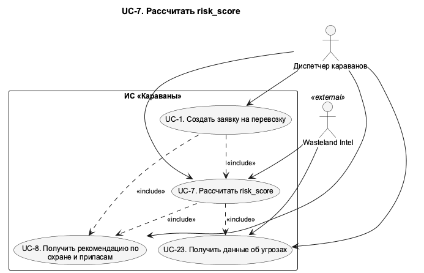

[PlantUML — прецедент](diagrams/usecases/UC_7_Detail.puml) · [Visual Paradigm XML — прецедент](diagrams/vp/out/usecases/UC_7_Detail.xml)

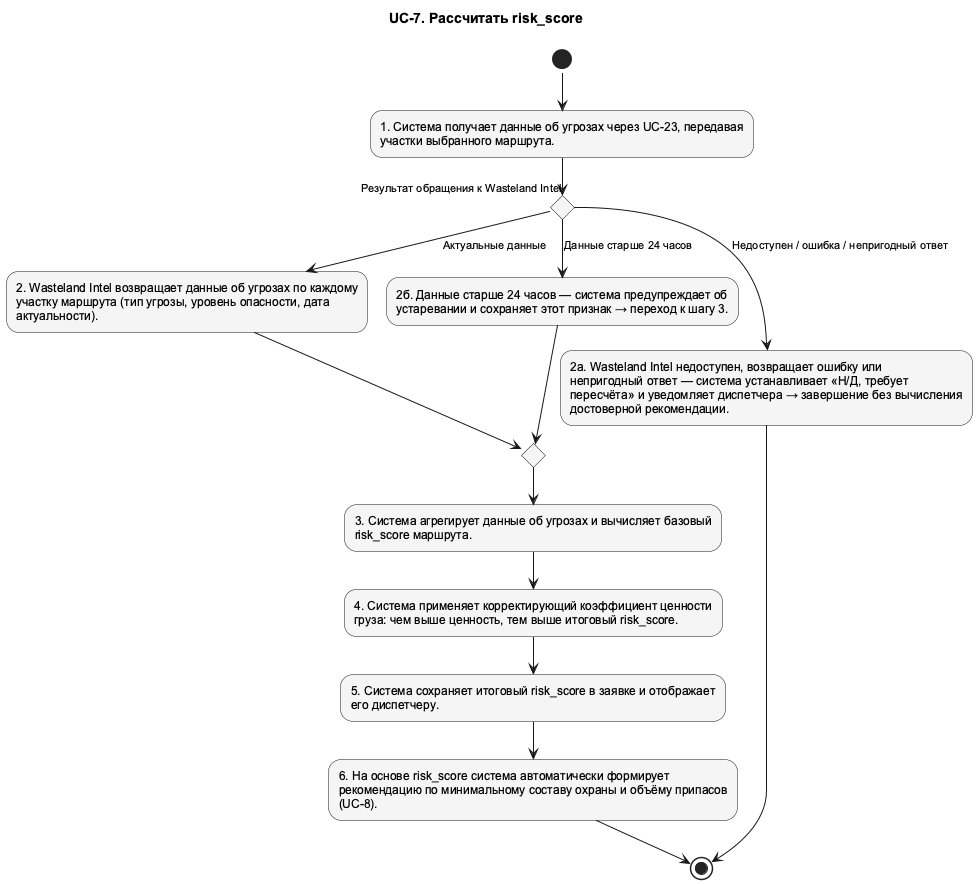

[PlantUML — активность](diagrams/usecases/UC_7_Activity.puml) · [Visual Paradigm XML — активность](diagrams/vp/out/usecases/UC_7_Activity.xml)

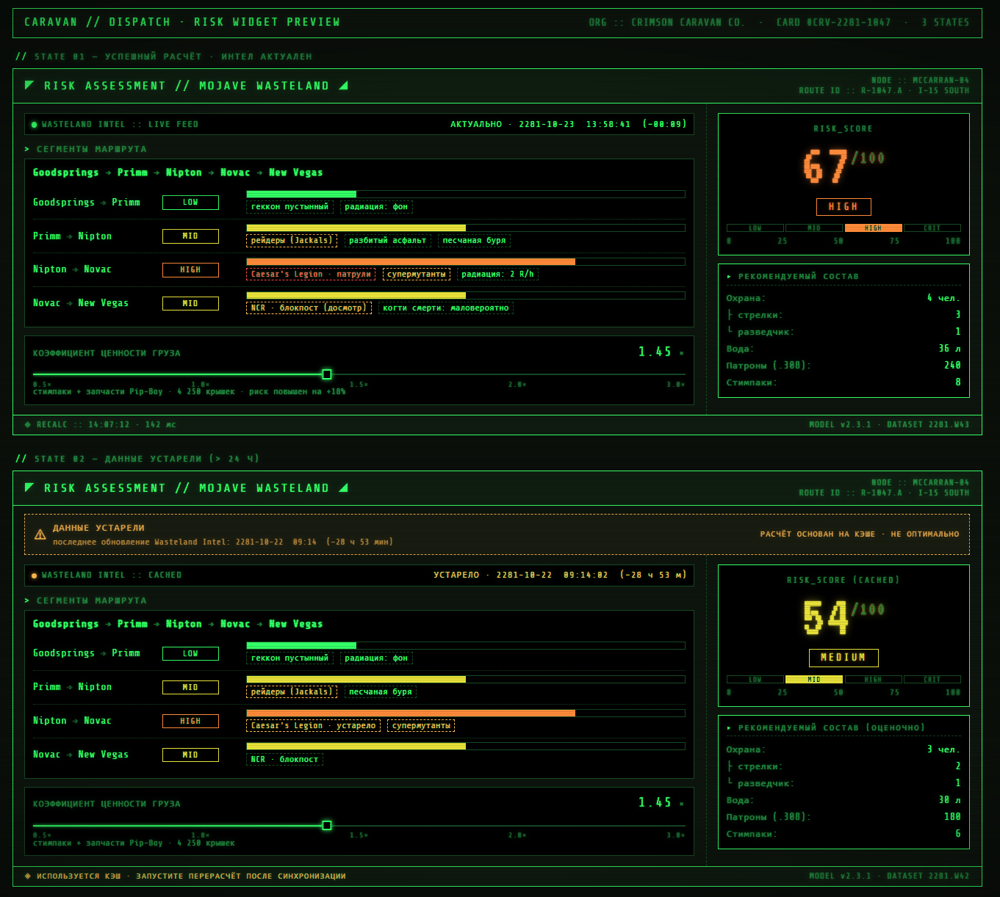

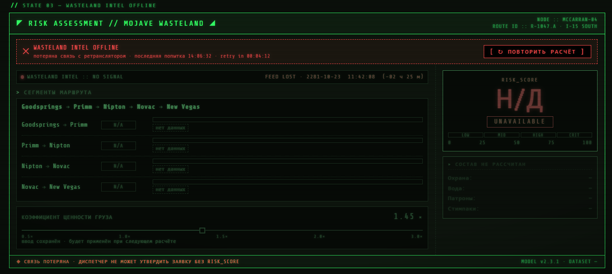

[Исходник макета](mockups/uc7_risk_score.html)

---

## UC-8. Получить рекомендацию по охране и припасам

| Прецедент: Получить рекомендацию по охране и припасам |
| :--- |
| **ID:** UC-8 |
| **Краткое описание:** На основе risk_score система формирует рекомендацию по минимальному составу охраны и объёму припасов; диспетчер может принять или скорректировать. |
| **Главные актёры:** Диспетчер караванов |
| **Второстепенные актёры:** Нет |
| **Предусловия:**  1. Диспетчер аутентифицирован и действует в рамках своей организации. 2. Для выбранного маршрута известно состояние risk_score: рассчитанное значение с актуальностью данных либо «Н/Д». |
| **Основной поток:**  1. Система получает итоговый risk_score и сведения о грузе и маршруте. 2. Система применяет принятые правила определения минимального состава охраны и объёма припасов. 3. Система формирует рекомендацию и показывает её вместе с уровнем риска. 4. Диспетчер просматривает рекомендацию и использует её при подготовке команды и припасов. 5. Система сохраняет рекомендацию в данных заявки. |
| **Альтернативные потоки:**  1а. Риск не рассчитан — система показывает необходимость выполнить UC-7 → завершение без новой рекомендации. 3а. Риск рассчитан по устаревшим данным — рекомендация сопровождается предупреждением → переход к шагу 4. 4а. Диспетчер выбирает другой состав подготовки — решение учитывается в UC-9 и UC-13, исходная рекомендация сохраняется для сопоставления → переход к шагу 5. |
| **Постусловия:**  1. Рекомендация связана с расчётом риска и доступна при подготовке рейса. 2. Сама рекомендация не подменяет назначения сотрудников и резервирование припасов. |

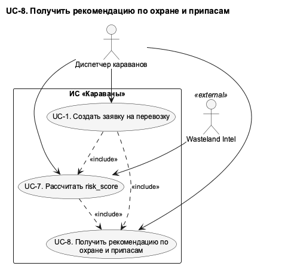

[PlantUML — прецедент](diagrams/usecases/UC_8_Detail.puml) · [Visual Paradigm XML — прецедент](diagrams/vp/out/usecases/UC_8_Detail.xml)

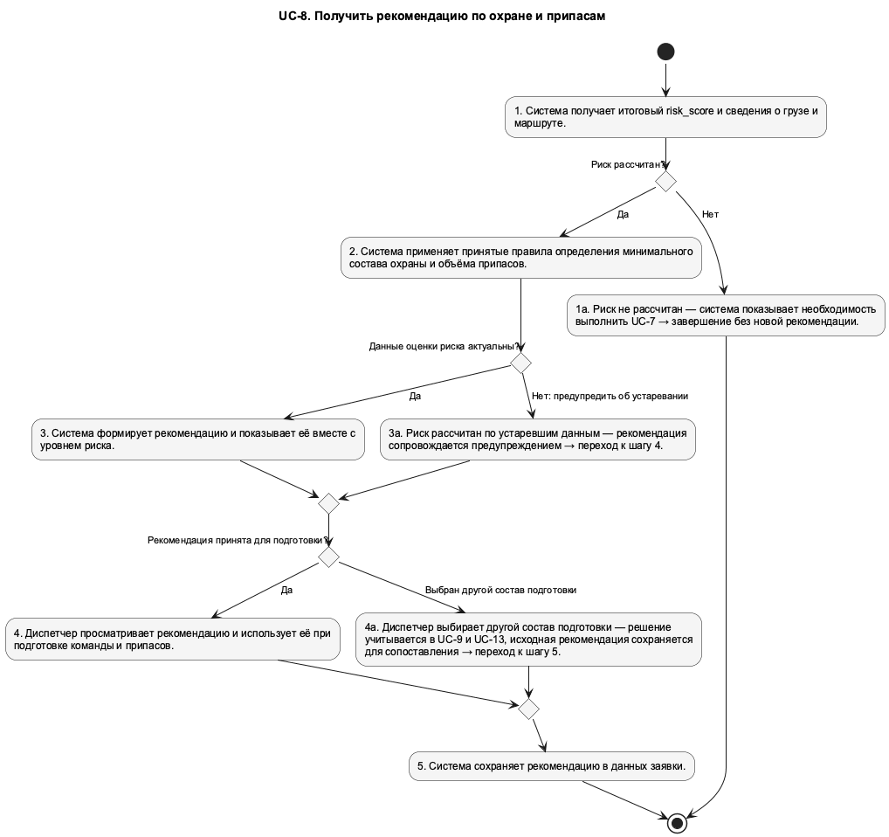

[PlantUML — активность](diagrams/usecases/UC_8_Activity.puml) · [Visual Paradigm XML — активность](diagrams/vp/out/usecases/UC_8_Activity.xml)

---

## UC-9. Назначить сотрудников на роли рейса

| Прецедент: Назначить сотрудников на роли рейса |
| :--- |
| **ID:** UC-9 |
| **Краткое описание:** Диспетчер назначает сотрудников на ключевые роли рейса. Система блокирует выпуск при незаполненных обязательных ролях. |
| **Главные актёры:** Диспетчер караванов |
| **Второстепенные актёры:** Нет |
| **Предусловия:**  1. Диспетчер аутентифицирован и действует в рамках своей организации. 2. Заявка существует и допускает подготовку или изменение команды. |
| **Основной поток:**  1. Диспетчер открывает состав команды рейса. 2. Система показывает доступных сотрудников с их занятостью и статусом через UC-10. 3. Диспетчер выбирает сотрудников и назначает их на ключевые роли рейса. 4. Система проверяет принадлежность сотрудников организации, доступность и корректность назначений. 5. Диспетчер подтверждает назначения. 6. Система сохраняет состав команды и показывает заполненность обязательных ролей. |
| **Альтернативные потоки:**  3а. Подходящего сотрудника нет — диспетчер оставляет роль незаполненной; выбранные для остальных ролей назначения всё равно проверяются → переход к шагу 4. 4а. Сотрудник недоступен либо назначение недопустимо — система объясняет причину → возврат к шагу 3. 5а. Диспетчер отменяет редактирование → завершение без изменения состава команды. |
| **Постусловия:**  1. Состав команды сохранён и связан с рейсом. 2. Незаполненные обязательные роли явно обозначены; выход в путь без них блокируется в UC-2. |
| **Включаемые прецеденты:** UC-10 «Просмотреть доступных сотрудников». |

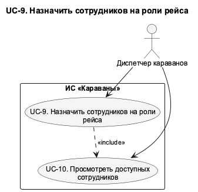

[PlantUML — прецедент](diagrams/usecases/UC_9_Detail.puml) · [Visual Paradigm XML — прецедент](diagrams/vp/out/usecases/UC_9_Detail.xml)

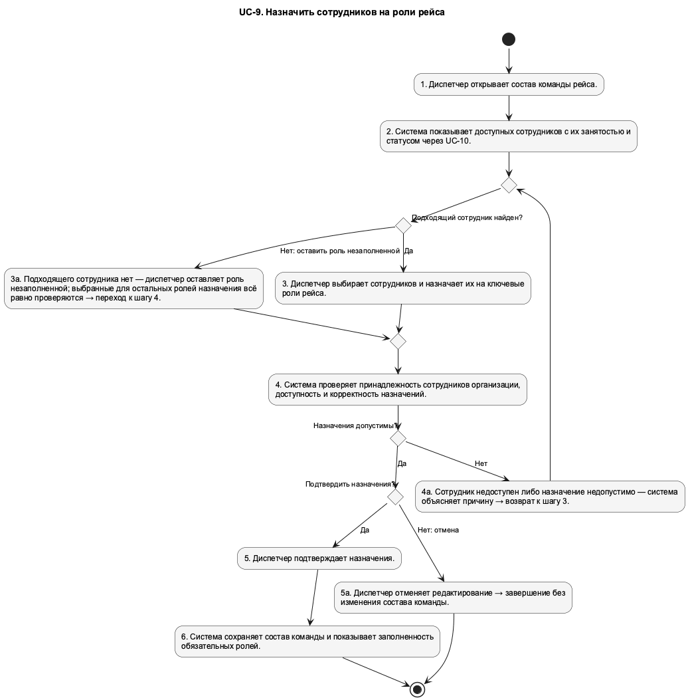

[PlantUML — активность](diagrams/usecases/UC_9_Activity.puml) · [Visual Paradigm XML — активность](diagrams/vp/out/usecases/UC_9_Activity.xml)

---

## UC-10. Просмотреть доступных сотрудников

| Прецедент: Просмотреть доступных сотрудников |
| :--- |
| **ID:** UC-10 |
| **Краткое описание:** Диспетчер просматривает список доступных сотрудников с указанием их текущей занятости и статуса. |
| **Главные актёры:** Диспетчер караванов |
| **Второстепенные актёры:** Нет |
| **Предусловия:**  1. Диспетчер аутентифицирован и действует в рамках своей организации. |
| **Основной поток:**  1. Диспетчер открывает список сотрудников для назначения на рейс. 2. Система определяет организацию и получает разрешённые сведения о её сотрудниках. 3. Система показывает сотрудников, их статус и текущую занятость. 4. Диспетчер просматривает список и выбирает подходящего сотрудника для дальнейшего назначения. |
| **Альтернативные потоки:**  3а. Доступных сотрудников нет — система показывает пустое состояние → завершение без назначения. 3б. Сведения не удалось загрузить — система сообщает об ошибке → завершение без изменения данных. |
| **Постусловия:**  1. Диспетчер получил актуальные доступные сведения о сотрудниках своей организации. 2. Просмотр сам по себе не изменяет назначения. |

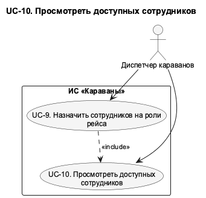

[PlantUML — прецедент](diagrams/usecases/UC_10_Detail.puml) · [Visual Paradigm XML — прецедент](diagrams/vp/out/usecases/UC_10_Detail.xml)

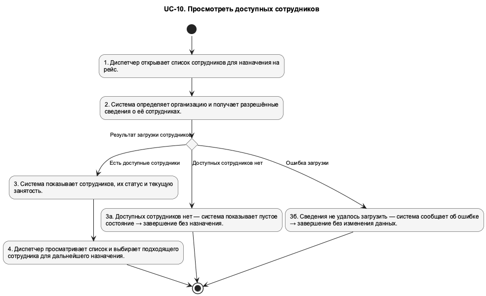

[PlantUML — активность](diagrams/usecases/UC_10_Activity.puml) · [Visual Paradigm XML — активность](diagrams/vp/out/usecases/UC_10_Activity.xml)

---

## UC-11. Создать груз-манифест

| Прецедент: Создать груз-манифест |
| :--- |
| **ID:** UC-11 |
| **Краткое описание:** Кладовщик создаёт цифровой груз-манифест с перечнем позиций, упаковкой и пломбами. |
| **Главные актёры:** Кладовщик |
| **Второстепенные актёры:** Нет |
| **Предусловия:**  1. Пользователь аутентифицирован, имеет указанную для прецедента роль и действует в пределах разрешённой организации. 2. Кладовщику доступна заявка своей организации на этапе подготовки груза. |
| **Основной поток:**  1. Кладовщик открывает груз-манифест заявки. 2. Кладовщик вводит позиции груза, количества и сведения об упаковке. 3. Кладовщик указывает сведения о пломбах для подготовленного груза. 4. Система проверяет обязательные поля и корректность количества и упаковки. 5. Кладовщик проверяет сводку и подтверждает сохранение. 6. Система сохраняет цифровой манифест, связывает его с заявкой и фиксирует изменение в аудите. |
| **Альтернативные потоки:**  4а. Данные позиции или пломбы неполны либо некорректны — система указывает ошибки → возврат к шагу 2. 5а. Кладовщик отменяет заполнение → завершение без сохранения нового манифеста. |
| **Постусловия:**  1. Манифест содержит позиции, количества, упаковку и сведения о пломбах и связан с заявкой. 2. Изменение отражено в аудите. |

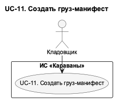

[PlantUML — прецедент](diagrams/usecases/UC_11_Detail.puml) · [Visual Paradigm XML — прецедент](diagrams/vp/out/usecases/UC_11_Detail.xml)

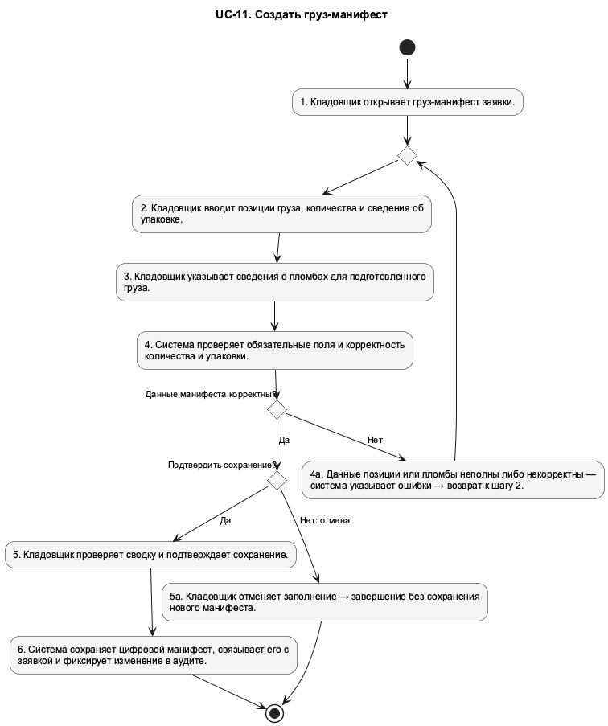

[PlantUML — активность](diagrams/usecases/UC_11_Activity.puml) · [Visual Paradigm XML — активность](diagrams/vp/out/usecases/UC_11_Activity.xml)

---

## UC-12. Указать ценность груза

| Прецедент: Указать ценность груза |
| :--- |
| **ID:** UC-12 |
| **Краткое описание:** Диспетчер указывает оценочную ценность груза (в крышках) при создании заявки; значение используется при расчёте risk_score. |
| **Главные актёры:** Диспетчер караванов |
| **Второстепенные актёры:** Нет |
| **Предусловия:**  1. Диспетчер аутентифицирован и действует в рамках своей организации. 2. Открыта форма создания или допустимого редактирования заявки. |
| **Основной поток:**  1. Диспетчер открывает поле оценочной ценности груза. 2. Диспетчер вводит стоимость в крышках. 3. Система проверяет корректность числового значения. 4. Система принимает значение в данные заявки и передаёт его в расчёт risk_score вызывающего сценария. |
| **Альтернативные потоки:**  2а. Диспетчер отменяет ввод → завершение с прежним значением. 3а. Значение отрицательное или не является допустимым числом — система показывает ошибку → возврат к шагу 2. |
| **Постусловия:**  1. В данных заявки задана оценочная ценность груза. 2. Последующий расчёт риска использует принятое значение. |

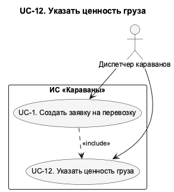

[PlantUML — прецедент](diagrams/usecases/UC_12_Detail.puml) · [Visual Paradigm XML — прецедент](diagrams/vp/out/usecases/UC_12_Detail.xml)

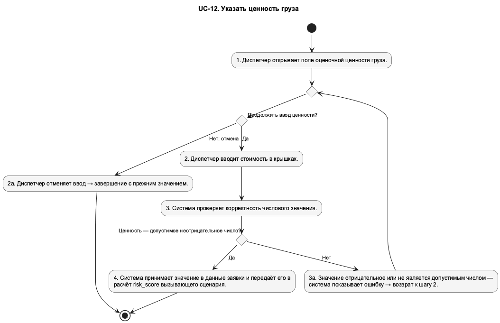

[PlantUML — активность](diagrams/usecases/UC_12_Activity.puml) · [Visual Paradigm XML — активность](diagrams/vp/out/usecases/UC_12_Activity.xml)

---

## UC-13. Зарезервировать припасы

| Прецедент: Зарезервировать припасы |
| :--- |
| **ID:** UC-13 |
| **Краткое описание:** Кладовщик резервирует припасы под рейс (вода, еда, боеприпасы, ремкомплекты, медприпасы). |
| **Главные актёры:** Кладовщик |
| **Второстепенные актёры:** Нет |
| **Предусловия:**  1. Пользователь аутентифицирован, имеет указанную для прецедента роль и действует в пределах разрешённой организации. 2. Кладовщику доступен рейс на этапе подготовки; известен требуемый состав припасов. |
| **Основной поток:**  1. Кладовщик открывает резервирование припасов для рейса. 2. Система показывает доступные запасы воды, еды, боеприпасов, ремкомплектов и медикаментов. 3. Кладовщик задаёт состав и количество припасов с учётом потребности рейса. 4. Система проверяет количества и наличие требуемых запасов. 5. Кладовщик подтверждает резервирование. 6. Система сохраняет резерв, связанный с рейсом, и отображает зарезервированные количества. |
| **Альтернативные потоки:**  4а. Запасов недостаточно — система показывает недостающие позиции → возврат к шагу 3. 4б. Количество некорректно — система указывает ошибку → возврат к шагу 3. 5а. Кладовщик отменяет действие → завершение без изменения резервов. |
| **Постусловия:**  1. Припасы зарезервированы для указанного рейса. 2. Резерв отражён в доступном остатке и данных подготовки рейса. |

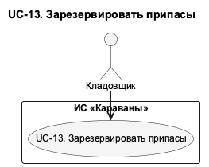

[PlantUML — прецедент](diagrams/usecases/UC_13_Detail.puml) · [Visual Paradigm XML — прецедент](diagrams/vp/out/usecases/UC_13_Detail.xml)

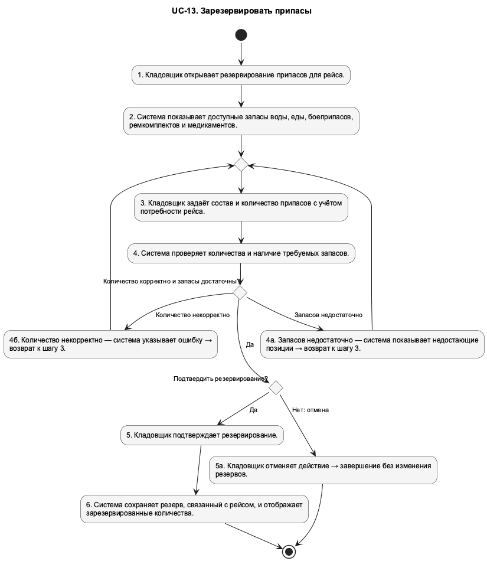

[PlantUML — активность](diagrams/usecases/UC_13_Activity.puml) · [Visual Paradigm XML — активность](diagrams/vp/out/usecases/UC_13_Activity.xml)

---

## UC-14. Подтвердить доставку груза (с пломбой)

| Прецедент: Подтвердить доставку груза (с пломбой) |
| :--- |
| **ID:** UC-14 |
| **Краткое описание:** Караван-мастер подтверждает факт доставки груза с фиксацией целостности пломбы (статус Delivered). |
| **Главные актёры:** Караван-мастер |
| **Второстепенные актёры:** Нет |
| **Предусловия:**  1. Караван-мастер аутентифицирован и назначен на рейс своей организации. 2. Рейс находится в En Route, груз прибыл в пункт назначения; доступен манифест с пломбой. |
| **Основной поток:**  1. Караван-мастер выбирает событие доставки в UC-16 и открывает подтверждение доставки. 2. Караван-мастер сверяет пломбу и указывает её идентификатор и фактическую целостность. 3. Караван-мастер подтверждает факт передачи груза получателю. 4. Клиент фиксирует идентификатор события, время и координаты доставки. 5. Система проверяет допустимость доставки, сохраняет подтверждение и переводит рейс в Delivered с записью истории и аудита. 6. Система показывает факт доставки и сведения о пломбе для последующей приёмки UC-15. |
| **Альтернативные потоки:**  2а. Пломба повреждена или не соответствует манифесту — караван-мастер фиксирует фактическое состояние → переход к шагу 3; расхождение учитывается при приёмке. 3а. Передача груза не состоялась или пользователь отменил подтверждение → завершение без события доставки. 5а. Связи нет — подтверждение сохраняется в локальной очереди; серверный статус не считается изменённым до успешной синхронизации → завершение с ожидающим отправки событием. 5б. Сервер отклоняет переход — система показывает причину, Delivered не устанавливается → завершение без подтверждённого перехода. |
| **Постусловия:**  1. Факт доставки и состояние пломбы сохранены; рейс имеет статус Delivered. 2. Приёмка и закрытие рейса выполняются отдельно; подтверждение доставки не означает автоматически совпадение манифеста. |
| **Расширяемый прецедент:** UC-16, EP-3 «Подтверждение доставки», при событии передачи груза получателю. |

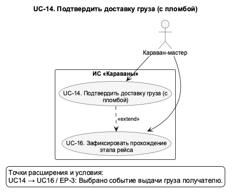

[PlantUML — прецедент](diagrams/usecases/UC_14_Detail.puml) · [Visual Paradigm XML — прецедент](diagrams/vp/out/usecases/UC_14_Detail.xml)

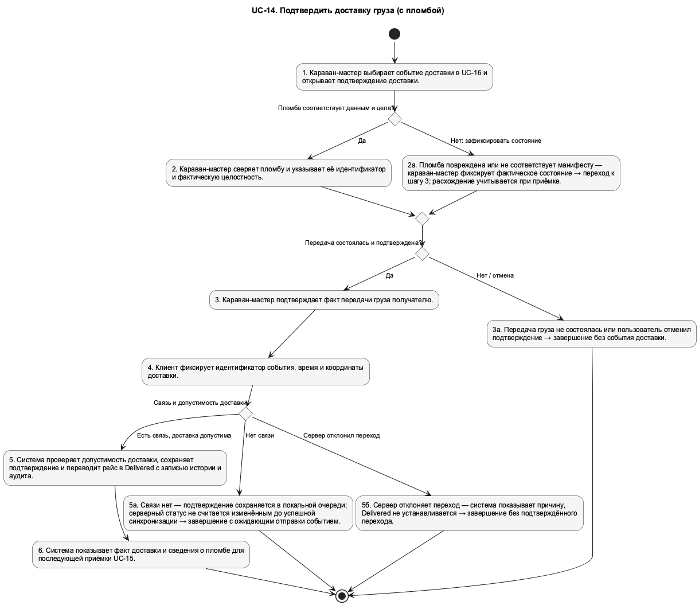

[PlantUML — активность](diagrams/usecases/UC_14_Activity.puml) · [Visual Paradigm XML — активность](diagrams/vp/out/usecases/UC_14_Activity.xml)

---

## UC-15. Выполнить сверку манифеста при приёмке

| Прецедент: Выполнить сверку манифеста при приёмке |
| :--- |
| **ID:** UC-15 |
| **Краткое описание:** Кладовщик на принимающей стороне выполняет сверку груз-манифеста и фиксирует результат. При отсутствии кладовщика приёмку закрывает караван-мастер. |
| **Главные актёры:** Кладовщик; Караван-мастер при отсутствии кладовщика на принимающей стороне |
| **Второстепенные актёры:** Нет |
| **Предусловия:**  1. Пользователь аутентифицирован, имеет указанную для прецедента роль и действует в пределах разрешённой организации. 2. Груз прибыл на принимающую сторону; доступны манифест и сведения о пломбе и доставке. |
| **Основной поток:**  1. Кладовщик принимающей стороны открывает приёмку рейса. 2. Кладовщик осматривает пломбу и сопоставляет её сведения с подтверждением доставки. 3. Кладовщик сверяет фактические позиции и количества с манифестом. 4. Кладовщик фиксирует результат «Совпадение» и подтверждает приёмку. 5. Система сохраняет результат сверки, ответственного и время, фиксирует изменение в аудите. 6. Система показывает закрытую приёмку и её результат для последующего закрытия рейса диспетчером. |
| **Альтернативные потоки:**  1а. Кладовщик на принимающей стороне отсутствует — приёмку единолично выполняет караван-мастер (FR-17) → переход к шагу 2 с этим исполнителем. 2а. Пломба нарушена или не соответствует данным — исполнитель фиксирует нарушение → переход к шагу 3. 3а. Обнаружены недостача, повреждения либо несовпадение позиций — исполнитель указывает ожидаемое, фактическое и комментарий, выбирает «Расхождение» и подтверждает результат сверки → переход к шагу 5. 4а. Исполнитель отменяет подтверждение → завершение без закрытия приёмки. |
| **Постусловия:**  1. Приёмка завершена с результатом «Совпадение» либо «Расхождение» и данными ответственного. 2. Сохранены сведения о пломбе и расхождениях; сама приёмка не заменяет финансовое закрытие рейса. |

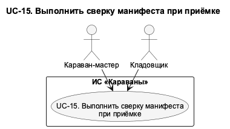

[PlantUML — прецедент](diagrams/usecases/UC_15_Detail.puml) · [Visual Paradigm XML — прецедент](diagrams/vp/out/usecases/UC_15_Detail.xml)

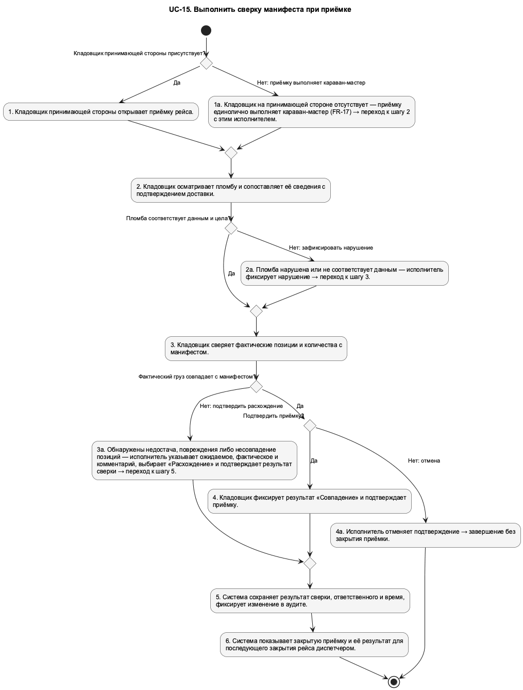

[PlantUML — активность](diagrams/usecases/UC_15_Activity.puml) · [Visual Paradigm XML — активность](diagrams/vp/out/usecases/UC_15_Activity.xml)

---

## UC-16. Зафиксировать прохождение этапа рейса

| Прецедент: Зафиксировать прохождение этапа рейса |
| :--- |
| **ID:** UC-16 |
| **Краткое описание:** Караван-мастер фиксирует факт прохождения очередного физического этапа рейса (загрузка завершена, караван вышел, прибытие на контрольную точку, груз выдан получателю). Результат — запись в CheckpointLog и предусмотренный событием переход статуса, если он необходим. |
| **Главные актёры:** Караван-мастер |
| **Второстепенные актёры:** Нет |
| **Предусловия:**  1. Караван-мастер аутентифицирован и назначен на рейс своей организации. 2. Рейс находится в Ready или En Route; произошло физическое событие, требующее фиксации этапа. |
| **Основной поток:**  1. Караван-мастер открывает карточку рейса на полевом устройстве. 2. Клиент показывает текущий этап и допустимые следующие события. 3. Караван-мастер выбирает произошедшее физическое событие; для КТ, КПП или доставки выполняется соответствующее расширение UC-17, UC-18 или UC-14. 4. Клиент фиксирует идентификатор, время и координаты события. 5. Система проверяет порядок этапов и применимость события к текущему состоянию рейса. 6. Система сохраняет CheckpointLog и выполняет предусмотренный событием переход статуса с историей и аудитом; если переход не требуется, текущий статус сохраняется. |
| **Альтернативные потоки:**  5а. Этап фиксируется вне допустимого порядка — система показывает причину → возврат к шагу 2. 5б. Связи нет — клиент сохраняет событие локально для автоматической передачи после восстановления связи → завершение с ожидающим отправки событием. 6а. При синхронизации поступило ранее принятое событие — система возвращает подтверждение без повторной записи и изменения статуса → завершение с прежним подтверждённым результатом. |
| **Постусловия:**  1. Этап сохранён с временем и координатами и связан с рейсом. 2. Статус изменён только при предусмотренном переходе; повторная передача того же события не создаёт повторного эффекта. |
| **Точки расширения:**  EP-1 «Прибытие на контрольную точку» (шаг 3) — UC-17. EP-2 «Прохождение КПП» (шаг 3) — UC-18. EP-3 «Подтверждение доставки» (шаг 3) — UC-14. |

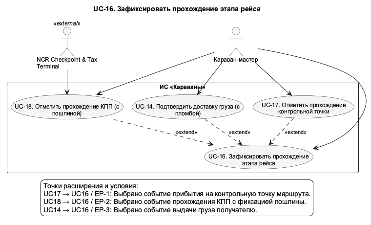

[PlantUML — прецедент](diagrams/usecases/UC_16_Detail.puml) · [Visual Paradigm XML — прецедент](diagrams/vp/out/usecases/UC_16_Detail.xml)

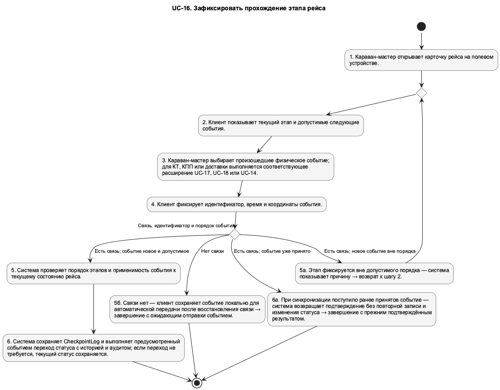

[PlantUML — активность](diagrams/usecases/UC_16_Activity.puml) · [Visual Paradigm XML — активность](diagrams/vp/out/usecases/UC_16_Activity.xml)

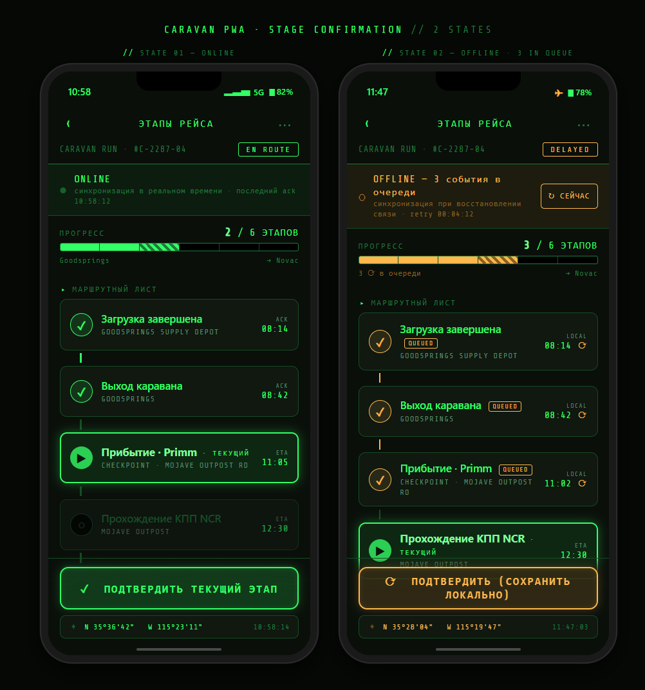

[Исходник макета](mockups/uc16_caravan_stages.html)

---

## UC-17. Отметить прохождение контрольной точки

| Прецедент: Отметить прохождение контрольной точки |
| :--- |
| **ID:** UC-17 |
| **Краткое описание:** Караван-мастер фиксирует прохождение контрольной точки на маршруте (CheckpointLog). |
| **Главные актёры:** Караван-мастер |
| **Второстепенные актёры:** Нет |
| **Предусловия:**  1. Караван-мастер аутентифицирован и назначен на рейс своей организации. 2. Рейс находится в En Route; караван прошёл контрольную точку своего маршрута. |
| **Основной поток:**  1. Караван-мастер выбирает в UC-16 событие прохождения контрольной точки. 2. Клиент показывает контрольные точки выбранного маршрута. 3. Караван-мастер выбирает пройденную точку и подтверждает отметку. 4. Клиент фиксирует идентификатор, время и координаты события. 5. Система проверяет принадлежность точки маршруту и порядок прохождения. 6. Система сохраняет отметку в CheckpointLog и возвращает результат в UC-16. |
| **Альтернативные потоки:**  3а. Пользователь отменяет отметку → завершение без нового события. 5а. Точка не принадлежит маршруту или нарушен порядок — система показывает причину → возврат к шагу 2. 5б. Связи нет — отметка сохраняется в локальной очереди для передачи с исходными временем и координатами → завершение с ожидающим отправки событием. |
| **Постусловия:**  1. Пройденная контрольная точка отражена в журнале рейса. 2. Промежуточная точка сама по себе не переводит рейс в Delivered. |
| **Расширяемый прецедент:** UC-16, EP-1 «Прибытие на контрольную точку», при прохождении точки маршрута. |

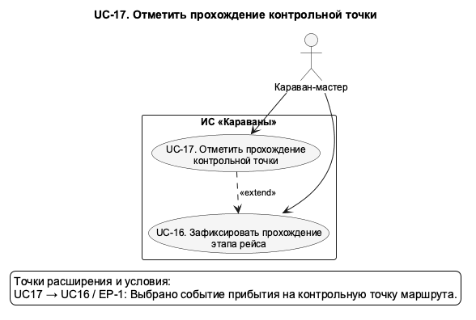

[PlantUML — прецедент](diagrams/usecases/UC_17_Detail.puml) · [Visual Paradigm XML — прецедент](diagrams/vp/out/usecases/UC_17_Detail.xml)

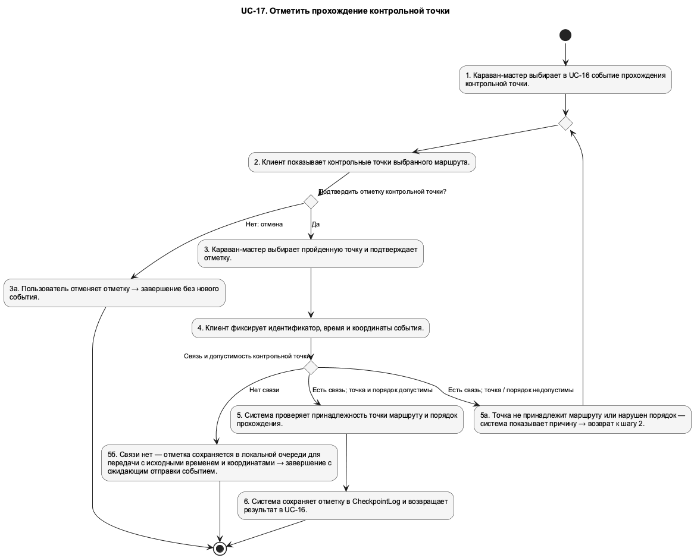

[PlantUML — активность](diagrams/usecases/UC_17_Activity.puml) · [Visual Paradigm XML — активность](diagrams/vp/out/usecases/UC_17_Activity.xml)

---

## UC-18. Отметить прохождение КПП (с пошлиной)

| Прецедент: Отметить прохождение КПП (с пошлиной) |
| :--- |
| **ID:** UC-18 |
| **Краткое описание:** Караван-мастер отмечает прохождение КПП; система запрашивает данные с терминала NCR (название, сумма пошлины, валюта) и записывает в финансовый журнал. |
| **Главные актёры:** Караван-мастер |
| **Второстепенные актёры:** NCR Checkpoint & Tax Terminal |
| **Предусловия:**  1. Караван-мастер аутентифицирован и назначен на рейс своей организации. 2. Рейс находится в En Route; караван проходит КПП на маршруте. |
| **Основной поток:**  1. Караван-мастер выбирает в UC-16 событие прохождения КПП. 2. Караван-мастер указывает КПП; система получает данные через UC-24. 3. Система показывает название КПП, сумму пошлины и исходную валюту. 4. Караван-мастер сверяет сведения и подтверждает прохождение и фактическую пошлину. 5. Система фиксирует идентификатор события, время и координаты, сохраняет запись КПП и финансовую запись, связанную с рейсом. 6. Система возвращает подтверждение в UC-16 и показывает учтённую пошлину. |
| **Альтернативные потоки:**  2а. Сведения NCR недоступны — клиент сохраняет событие прохождения с пометкой об отсутствии подтверждённой пошлины для последующего получения внешних данных; неподтверждённая сумма не учитывается как установленная пошлина → завершение с ожидающим уточнения событием. 4а. Пошлина либо валюта не согласованы с фактическими данными — караван-мастер исправляет сведения → возврат к шагу 3. 4б. Пользователь отменяет отметку → завершение без записи прохождения. 5а. Связи с сервером нет — данные сохраняются локально для последующей синхронизации → завершение с ожидающим отправки событием. |
| **Постусловия:**  1. Прохождение КПП отражено в журнале рейса, пошлина — в финансовых данных с исходной валютой. 2. Результат доступен для итогового отчёта. |
| **Расширяемый прецедент:** UC-16, EP-2 «Прохождение КПП», при прохождении КПП; включает UC-24 «Получить данные о КПП и пошлинах». |

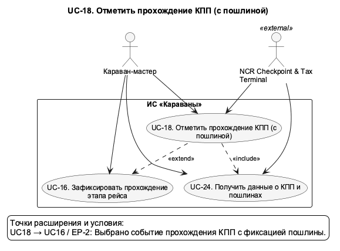

[PlantUML — прецедент](diagrams/usecases/UC_18_Detail.puml) · [Visual Paradigm XML — прецедент](diagrams/vp/out/usecases/UC_18_Detail.xml)

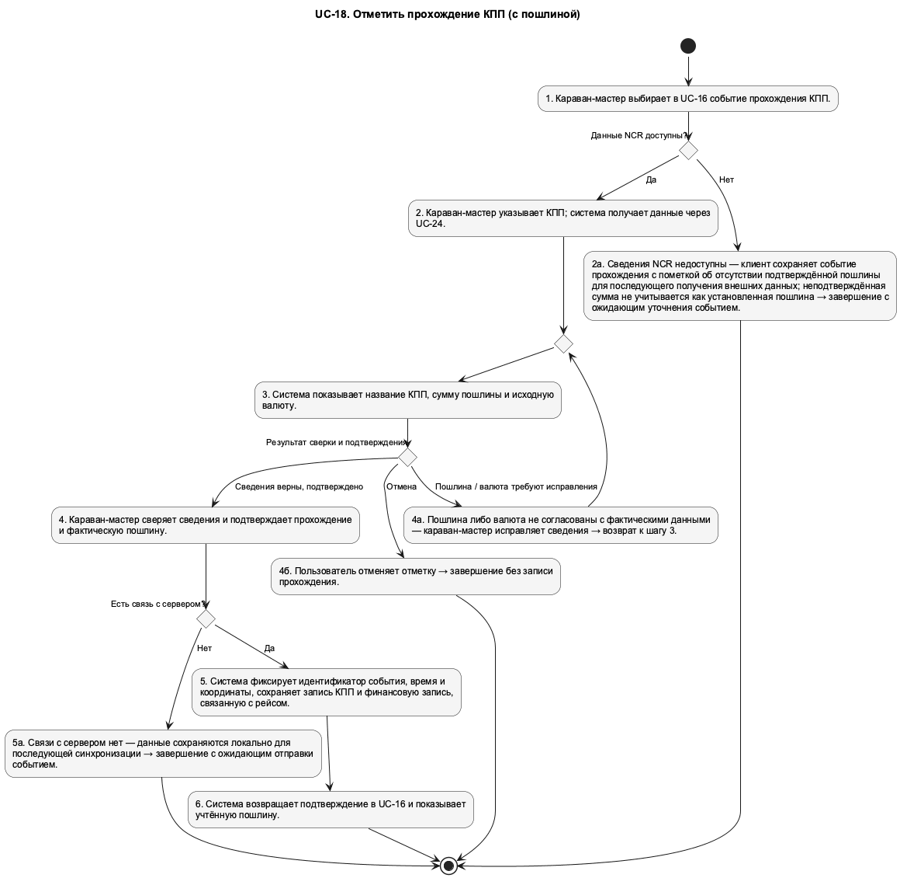

[PlantUML — активность](diagrams/usecases/UC_18_Activity.puml) · [Visual Paradigm XML — активность](diagrams/vp/out/usecases/UC_18_Activity.xml)

---

## UC-19. Сообщить об инциденте в рейсе

| Прецедент: Сообщить об инциденте в рейсе |
| :--- |
| **ID:** UC-19 |
| **Краткое описание:** Полевой пользователь сообщает о произошедшем в рейсе инциденте (нападение, поломка, медицинское происшествие, потеря груза и т.п.). Результат — карточка инцидента зарегистрирована, диспетчер уведомлён, при необходимости запускается реагирование. |
| **Главные актёры:** Полевой пользователь (обобщает Караван-мастера, Капитана охраны, Полевого медика) |
| **Второстепенные актёры:** Диспетчер караванов (получает уведомление) |
| **Предусловия:**  1. Полевой пользователь аутентифицирован, назначен на рейс своей организации и действует в пределах доступных ему данных. 2. Рейс находится в En Route или Delayed; произошёл инцидент. |
| **Основной поток:**  1. Полевой пользователь открывает единую форму сообщения об инциденте. 2. Клиент заполняет временную метку и координаты. 3. Пользователь выбирает тип инцидента. 4. Пользователь указывает тяжесть: низкая, средняя, высокая или критическая. 5. Пользователь вводит описание и при необходимости отмечает пострадавших участников команды. 6. Пользователь подтверждает сообщение; клиент проверяет обязательные поля. 7. Клиент присваивает идентификатор события и передаёт сообщение серверу с исходными временем и координатами. 8. Система регистрирует инцидент в рейсе; при высокой или критической тяжести и статусе En Route выполняет переход в Delayed с актором «Система», историей и аудитом. 9. Система уведомляет диспетчера; при необходимости диспетчер или караван-мастер инициирует UC-20. |
| **Альтернативные потоки:**  6а. Пользователь отменяет заполнение → завершение без регистрации инцидента. 6б. Обязательные поля не заполнены — клиент показывает ошибки → возврат к шагу 3. 7а. Связи нет — клиент присваивает сообщению идентификатор события до локального сохранения и сохраняет сообщение в очереди с исходными временем и координатами; синхронизация передаёт тот же идентификатор. Регистрация на сервере, изменение статуса и уведомление выполняются после успешной синхронизации → завершение с ожидающим отправки сообщением. 8а. Тяжесть низкая или средняя либо рейс уже Delayed — карточка сохраняется без нового перехода статуса → переход к шагу 9. |
| **Постусловия:**  1. Карточка инцидента связана с рейсом; при успешной передаче диспетчер уведомлён. 2. При высокой или критической тяжести рейс находится в Delayed; если он уже был задержан, повторный переход не выполняется. 3. RecoveryRequest создаётся отдельным решением уполномоченного пользователя при наличии необходимости. |
| **Точки расширения:**  EP-1 «Критический инцидент зарегистрирован» (шаг 9, высокая/критическая тяжесть и решение диспетчера или караван-мастера) — UC-20 «Инициировать RecoveryRequest». |

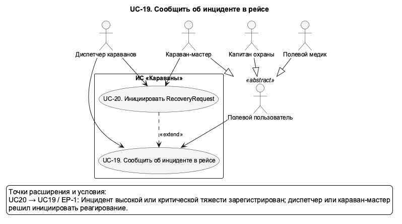

[PlantUML — прецедент](diagrams/usecases/UC_19_Detail.puml) · [Visual Paradigm XML — прецедент](diagrams/vp/out/usecases/UC_19_Detail.xml)

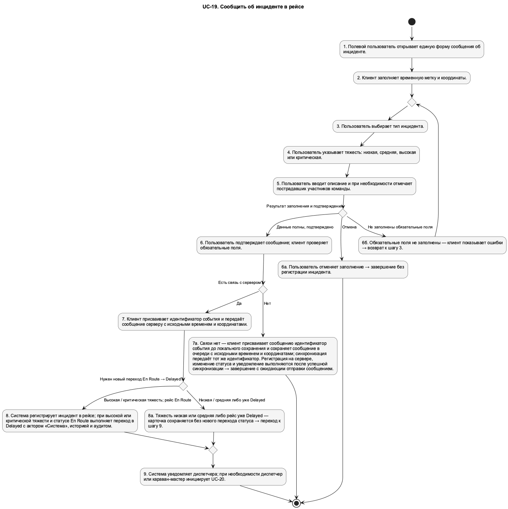

[PlantUML — активность](diagrams/usecases/UC_19_Activity.puml) · [Visual Paradigm XML — активность](diagrams/vp/out/usecases/UC_19_Activity.xml)

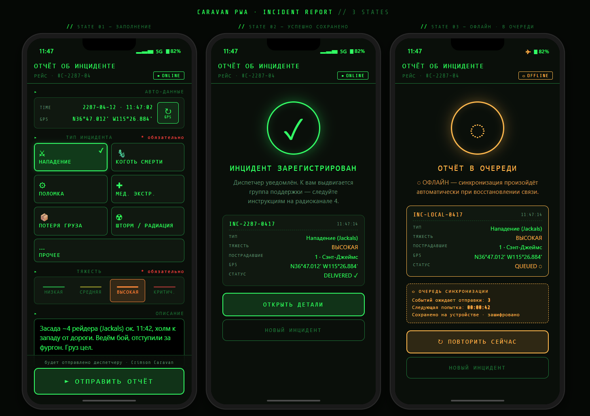

[Исходник макета](mockups/uc19_incident_report.html)

---

## UC-20. Инициировать RecoveryRequest

| Прецедент: Инициировать RecoveryRequest |
| :--- |
| **ID:** UC-20 |
| **Краткое описание:** На основе зафиксированного инцидента инициируется запрос на эвакуацию, подмогу или повторную доставку груза. |
| **Главные актёры:** Диспетчер караванов, Караван-мастер |
| **Второстепенные актёры:** Нет |
| **Предусловия:**  1. Пользователь аутентифицирован, имеет указанную для прецедента роль и действует в пределах разрешённой организации. 2. Пользователь — диспетчер либо назначенный караван-мастер; существует зарегистрированный инцидент, требующий реагирования. |
| **Основной поток:**  1. Пользователь открывает зарегистрированный инцидент рейса. 2. Пользователь выбирает создание RecoveryRequest. 3. Пользователь указывает вид помощи: эвакуация, подмога или повторная доставка, и необходимые сведения. 4. Система проверяет обязательные поля и связь запроса с инцидентом и рейсом. 5. Пользователь подтверждает запрос. 6. Система сохраняет RecoveryRequest, связывает его с инцидентом и рейсом и показывает результат диспетчеру и караван-мастеру в пределах их прав. |
| **Альтернативные потоки:**  4а. Данные неполны или инцидент недоступен — система поясняет причину → возврат к шагу 3. 5а. Пользователь отменяет запрос → завершение без нового RecoveryRequest. 6а. Сервер недоступен — система не подтверждает создание запроса и предлагает повторить действие → завершение без подтверждённого RecoveryRequest. |
| **Постусловия:**  1. Создан запрос на реагирование, связанный с зарегистрированным инцидентом. 2. Само создание запроса не означает фактического выполнения помощи. |
| **Расширяемый прецедент:** UC-19, EP-1 «Критический инцидент зарегистрирован», при высокой/критической тяжести и решении диспетчера или караван-мастера. |

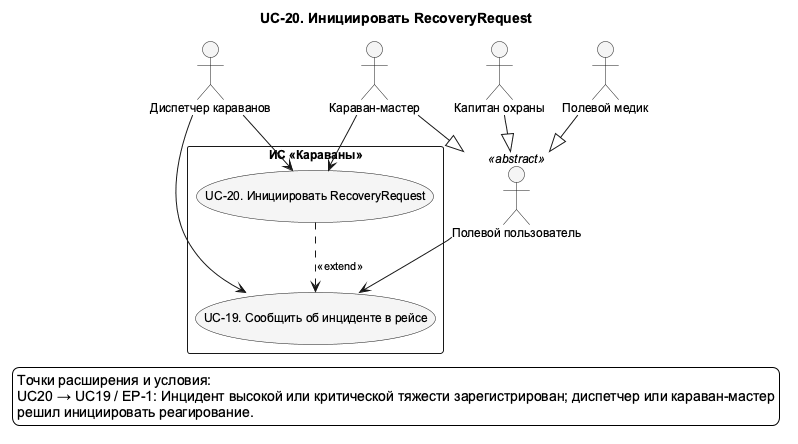

[PlantUML — прецедент](diagrams/usecases/UC_20_Detail.puml) · [Visual Paradigm XML — прецедент](diagrams/vp/out/usecases/UC_20_Detail.xml)

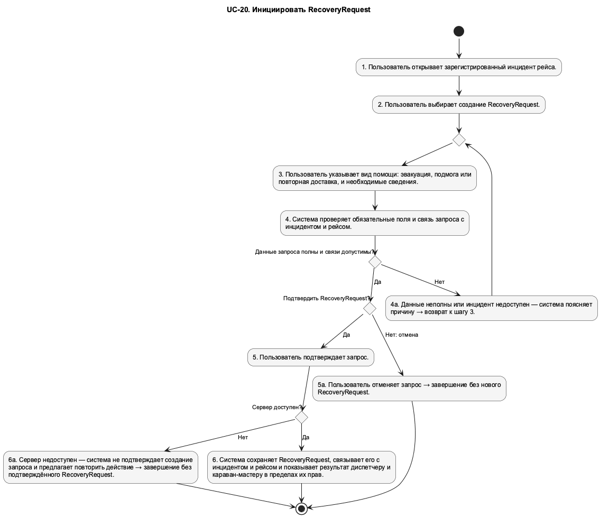

[PlantUML — активность](diagrams/usecases/UC_20_Activity.puml) · [Visual Paradigm XML — активность](diagrams/vp/out/usecases/UC_20_Activity.xml)

---

## UC-21. Сформировать финансовый отчёт по рейсу

| Прецедент: Сформировать финансовый отчёт по рейсу |
| :--- |
| **ID:** UC-21 |
| **Краткое описание:** Система автоматически формирует итоговый финансовый отчёт по рейсу (расходы, доходы, пошлины, расхождения, итого в крышках). |
| **Главные актёры:** Диспетчер караванов |
| **Второстепенные актёры:** Нет |
| **Предусловия:**  1. Диспетчер аутентифицирован и действует в рамках своей организации. 2. Рейс доставлен или закрыт; доступны данные заявки, команды, припасов, КПП и приёмки. |
| **Основной поток:**  1. Диспетчер открывает финансовый отчёт рейса. 2. Система собирает стоимость доставки, оплату команды, припасы, пошлины и зафиксированные расхождения. 3. Система приводит суммы к крышкам, сохраняя исходную валюту и использованный курс. 4. Система рассчитывает доходы, расходы и итоговый финансовый результат. 5. Система формирует и сохраняет отчёт по рейсу с расшифровкой исходных сумм. 6. Диспетчер просматривает отчёт; при необходимости отдельно запускает экспорт UC-22. |
| **Альтернативные потоки:**  2а. Не хватает необходимых финансовых данных — система перечисляет пробелы → завершение без подтверждённого итогового отчёта. 3а. Для исходной валюты не указан применяемый курс — система сообщает о необходимости уточнения → завершение без расчёта неподтверждённой итоговой суммы. |
| **Постусловия:**  1. Сформирован финансовый отчёт по конкретному рейсу с расшифровкой расчётов. 2. Отчёт доступен для просмотра и отдельного экспорта. |

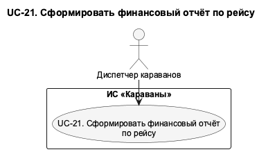

[PlantUML — прецедент](diagrams/usecases/UC_21_Detail.puml) · [Visual Paradigm XML — прецедент](diagrams/vp/out/usecases/UC_21_Detail.xml)

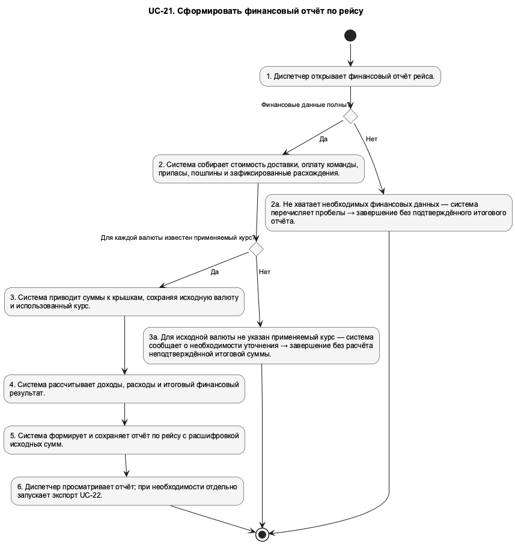

[PlantUML — активность](diagrams/usecases/UC_21_Activity.puml) · [Visual Paradigm XML — активность](diagrams/vp/out/usecases/UC_21_Activity.xml)

---

## UC-22. Экспортировать отчёт на голотейп

| Прецедент: Экспортировать отчёт на голотейп |
| :--- |
| **ID:** UC-22 |
| **Краткое описание:** Диспетчер экспортирует сформированный финансовый отчёт на голотейп для передачи клиенту. |
| **Главные актёры:** Диспетчер караванов |
| **Второстепенные актёры:** Нет |
| **Предусловия:**  1. Диспетчер аутентифицирован и действует в рамках своей организации. 2. Финансовый отчёт рейса сформирован; доступен целевой носитель или предусмотренное средство выгрузки на голотейп. |
| **Основной поток:**  1. Диспетчер открывает сформированный отчёт и выбирает экспорт. 2. Система показывает выбранный отчёт и предлагает целевой носитель выгрузки. 3. Диспетчер подтверждает экспорт на голотейп. 4. Система записывает отчёт на выбранный носитель. 5. Система проверяет завершение записи и сообщает результат экспорта. |
| **Альтернативные потоки:**  2а. Носитель отсутствует или недоступен для записи — система сообщает причину → завершение без подтверждённого экспорта. 3а. Диспетчер отменяет экспорт → завершение без записи. 4а. Запись прервана или не выполнена — система сообщает об ошибке → завершение без подтверждённого экспорта. |
| **Постусловия:**  1. На голотейпе получена копия выбранного отчёта. 2. Содержание отчёта и данные рейса экспортом не изменены. |

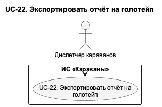

[PlantUML — прецедент](diagrams/usecases/UC_22_Detail.puml) · [Visual Paradigm XML — прецедент](diagrams/vp/out/usecases/UC_22_Detail.xml)

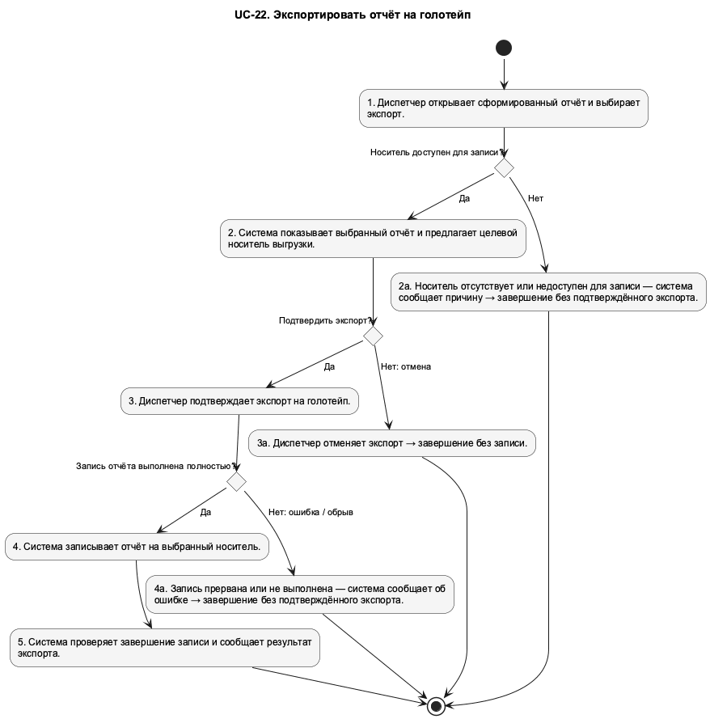

[PlantUML — активность](diagrams/usecases/UC_22_Activity.puml) · [Visual Paradigm XML — активность](diagrams/vp/out/usecases/UC_22_Activity.xml)

---

## UC-23. Получить данные об угрозах

| Прецедент: Получить данные об угрозах |
| :--- |
| **ID:** UC-23 |
| **Краткое описание:** Система интегрируется с Wasteland Intel для получения актуальных данных об угрозах на маршруте. |
| **Главные актёры:** Диспетчер караванов |
| **Второстепенные актёры:** Wasteland Intel |
| **Предусловия:**  1. Диспетчер аутентифицирован и действует в рамках своей организации. 2. Выполняется UC-7; определены участки маршрута, для которых нужны данные об угрозах. |
| **Основной поток:**  1. Система получает список участков маршрута от вызывающего расчёта UC-7. 2. Система формирует и отправляет запрос Wasteland Intel. 3. Wasteland Intel возвращает угрозы по участкам и дату актуальности. 4. Система проверяет формат, полноту и дату полученных данных. 5. Система возвращает данные и признак актуальности в UC-7. |
| **Альтернативные потоки:**  3а. Внешняя система недоступна, вернула ошибку или истёк таймаут — система возвращает результат недоступности в UC-7 → завершение без данных об угрозах. 4а. Ответ имеет непригодный формат или обязательные данные отсутствуют — система возвращает ошибку данных в UC-7 → завершение без принятия ответа. 4б. Данные старше 24 часов — система помечает их устаревшими → переход к шагу 5. |
| **Постусловия:**  1. Вызывающий расчёт получил проверенные данные об угрозах либо явный результат недоступности. 2. Сам UC-23 не вычисляет risk_score. |

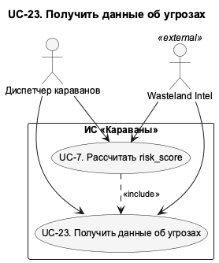

[PlantUML — прецедент](diagrams/usecases/UC_23_Detail.puml) · [Visual Paradigm XML — прецедент](diagrams/vp/out/usecases/UC_23_Detail.xml)

[PlantUML — активность](diagrams/usecases/UC_23_Activity.puml) · [Visual Paradigm XML — активность](diagrams/vp/out/usecases/UC_23_Activity.xml)

---

## UC-24. Получить данные о КПП и пошлинах

| Прецедент: Получить данные о КПП и пошлинах |
| :--- |
| **ID:** UC-24 |
| **Краткое описание:** Система интегрируется с NCR Checkpoint & Tax Terminal для получения данных о прохождении и суммах пошлин. |
| **Главные актёры:** Караван-мастер |
| **Второстепенные актёры:** NCR Checkpoint & Tax Terminal |
| **Предусловия:**  1. Караван-мастер аутентифицирован и назначен на рейс своей организации. 2. Выполняется UC-18; указан идентификатор КПП. |
| **Основной поток:**  1. Система получает идентификатор КПП из UC-18. 2. Система отправляет запрос в NCR Checkpoint & Tax Terminal. 3. Терминал возвращает сведения о КПП, прохождении, сумме пошлины и валюте. 4. Система проверяет соответствие КПП, формат суммы и наличие валюты. 5. Система возвращает проверенные сведения вызывающему UC-18. |
| **Альтернативные потоки:**  3а. Терминал недоступен, вернул ошибку или истёк таймаут — система возвращает признак недоступности в UC-18 → завершение без внешних данных. 4а. Ответ некорректен или относится к другому КПП — система не принимает сведения и сообщает об ошибке в UC-18 → завершение без внешних данных. |
| **Постусловия:**  1. UC-18 получил внешние сведения о КПП и пошлине либо явный результат недоступности. 2. Финансовая запись создаётся при подтверждении прохождения в UC-18. |

[PlantUML — прецедент](diagrams/usecases/UC_24_Detail.puml) · [Visual Paradigm XML — прецедент](diagrams/vp/out/usecases/UC_24_Detail.xml)

[PlantUML — активность](diagrams/usecases/UC_24_Activity.puml) · [Visual Paradigm XML — активность](diagrams/vp/out/usecases/UC_24_Activity.xml)

---

## UC-25. Аутентификация

| Прецедент: Аутентификация |
| :--- |
| **ID:** UC-25 |
| **Краткое описание:** Пользователь входит в систему по логину и паролю. Свободная регистрация отсутствует. |
| **Главные актёры:** Все пользователи (Диспетчер, Караван-мастер, Кладовщик, Капитан охраны, Полевой медик, Суперпользователь) |
| **Второстепенные актёры:** Нет |
| **Предусловия:**  1. Учётная запись пользователя ранее создана диспетчером либо суперпользователем; пользователь открыл клиент системы. |
| **Основной поток:**  1. Пользователь открывает форму входа. 2. Пользователь вводит логин и пароль. 3. Система проверяет учётные данные и активность учётной записи. 4. Система определяет роль, организацию и доступные полномочия пользователя. 5. Система создаёт аутентифицированную сессию и открывает доступный пользователю интерфейс. |
| **Альтернативные потоки:**  3а. Логин или пароль неверны — система сообщает об отказе без предоставления доступа → возврат к шагу 2. 3б. Учётная запись деактивирована — система отказывает во входе → завершение без сессии. 3в. Сервер недоступен — система сообщает об ошибке соединения → завершение без сессии. |
| **Постусловия:**  1. Пользователь аутентифицирован под своей учётной записью с установленными ролью и контекстом организации. 2. Свободная регистрация пользователя не выполнялась. |

[PlantUML — прецедент](diagrams/usecases/UC_25_Detail.puml) · [Visual Paradigm XML — прецедент](diagrams/vp/out/usecases/UC_25_Detail.xml)

[PlantUML — активность](diagrams/usecases/UC_25_Activity.puml) · [Visual Paradigm XML — активность](diagrams/vp/out/usecases/UC_25_Activity.xml)

---

## UC-26. Создать учётную запись пользователя

| Прецедент: Создать учётную запись пользователя |
| :--- |
| **ID:** UC-26 |
| **Краткое описание:** Диспетчер создаёт учётную запись пользователя своей организации с указанием роли, ФИО и начальных учётных данных; суперпользователь выполняет то же действие для выбранной организации. |
| **Главные актёры:** Диспетчер караванов; Суперпользователь при администрировании выбранной организации |
| **Второстепенные актёры:** Нет |
| **Предусловия:**  1. Диспетчер аутентифицирован и действует в своей организации либо суперпользователь аутентифицирован и выбрал целевую организацию. |
| **Основной поток:**  1. Диспетчер открывает управление пользователями организации и выбирает создание учётной записи. 2. Диспетчер вводит ФИО, роль, логин и начальные учётные данные. 3. Система проверяет обязательные поля, допустимость роли и уникальность логина. 4. Диспетчер подтверждает создание. 5. Система создаёт активную учётную запись, связывает её с выбранной организацией и фиксирует действие в аудите. 6. Система показывает созданного пользователя в списке организации. |
| **Альтернативные потоки:**  1а. Создание инициирует суперпользователь для выбранной организации — далее он выполняет действия диспетчера в шагах 2–6 в контексте этой организации → переход к шагу 2. 3а. Логин занят или данные некорректны — система указывает ошибку → возврат к шагу 2. 3б. Запрошена роль или организация вне полномочий диспетчера — система отклоняет создание → завершение без пользователя. 4а. Диспетчер отменяет создание → завершение без пользователя. |
| **Постусловия:**  1. Создан пользователь указанной роли в выбранной организации в пределах полномочий инициатора. 2. В аудите зафиксированы автор, время и содержание создания без раскрытия пароля. |

[PlantUML — прецедент](diagrams/usecases/UC_26_Detail.puml) · [Visual Paradigm XML — прецедент](diagrams/vp/out/usecases/UC_26_Detail.xml)

[PlantUML — активность](diagrams/usecases/UC_26_Activity.puml) · [Visual Paradigm XML — активность](diagrams/vp/out/usecases/UC_26_Activity.xml)

---

## UC-27. Изменить роль пользователя

| Прецедент: Изменить роль пользователя |
| :--- |
| **ID:** UC-27 |
| **Краткое описание:** Диспетчер изменяет роль существующего пользователя в рамках своей организации. |
| **Главные актёры:** Диспетчер караванов |
| **Второстепенные актёры:** Нет |
| **Предусловия:**  1. Диспетчер аутентифицирован и действует в рамках своей организации. 2. В организации существует пользователь, роль которого требуется изменить. |
| **Основной поток:**  1. Диспетчер открывает карточку пользователя своей организации. 2. Система показывает текущую роль и допустимые варианты. 3. Диспетчер выбирает новую роль. 4. Система проверяет полномочия и допустимость изменения роли. 5. Диспетчер подтверждает изменение. 6. Система сохраняет новую роль и фиксирует автора, время и изменение в аудите. |
| **Альтернативные потоки:**  4а. Выбран чужой пользователь или недопустимая роль — система отклоняет действие → завершение без изменения роли. 4б. Смена роли лишит организацию последнего активного диспетчера — система отклоняет действие → завершение без изменения роли. 5а. Диспетчер отменяет изменение → завершение с прежней ролью. |
| **Постусловия:**  1. Роль пользователя изменена в пределах организации, новая роль определяет его полномочия. 2. Изменение зафиксировано в аудите. |

[PlantUML — прецедент](diagrams/usecases/UC_27_Detail.puml) · [Visual Paradigm XML — прецедент](diagrams/vp/out/usecases/UC_27_Detail.xml)

[PlantUML — активность](diagrams/usecases/UC_27_Activity.puml) · [Visual Paradigm XML — активность](diagrams/vp/out/usecases/UC_27_Activity.xml)

---

## UC-28. Деактивировать учётную запись

| Прецедент: Деактивировать учётную запись |
| :--- |
| **ID:** UC-28 |
| **Краткое описание:** Диспетчер деактивирует учётную запись пользователя; система запрещает деактивацию последнего диспетчера в организации. |
| **Главные актёры:** Диспетчер караванов |
| **Второстепенные актёры:** Нет |
| **Предусловия:**  1. Диспетчер аутентифицирован и действует в рамках своей организации. 2. В организации существует учётная запись для деактивации. |
| **Основной поток:**  1. Диспетчер открывает карточку пользователя своей организации. 2. Диспетчер выбирает деактивацию учётной записи. 3. Система проверяет полномочия и наличие другого активного диспетчера, если отключается диспетчер. 4. Диспетчер подтверждает деактивацию. 5. Система помечает учётную запись неактивной и прекращает доступ пользователя к защищённым операциям. 6. Система фиксирует автора, время и содержание деактивации в аудите. |
| **Альтернативные потоки:**  3а. Отключается последний активный диспетчер — система запрещает деактивацию → завершение без изменения записи. 3б. Пользователь принадлежит другой организации — система отклоняет действие → завершение без изменения записи. 4а. Диспетчер отменяет действие → завершение без деактивации. |
| **Постусловия:**  1. Пользователь деактивирован и не имеет доступа к системе. 2. История его действий сохранена, в организации остаётся активный диспетчер; деактивация отражена в аудите. |

[PlantUML — прецедент](diagrams/usecases/UC_28_Detail.puml) · [Visual Paradigm XML — прецедент](diagrams/vp/out/usecases/UC_28_Detail.xml)

[PlantUML — активность](diagrams/usecases/UC_28_Activity.puml) · [Visual Paradigm XML — активность](diagrams/vp/out/usecases/UC_28_Activity.xml)

---

## UC-29. Редактировать свои учётные данные

| Прецедент: Редактировать свои учётные данные |
| :--- |
| **ID:** UC-29 |
| **Краткое описание:** Пользователь редактирует собственные учётные данные (логин, пароль). |
| **Главные актёры:** Все пользователи |
| **Второстепенные актёры:** Нет |
| **Предусловия:**  1. Пользователь аутентифицирован под собственной активной учётной записью. |
| **Основной поток:**  1. Пользователь открывает настройки своих учётных данных. 2. Пользователь вводит новый логин и/или пароль. 3. Система проверяет допустимость данных и уникальность нового логина. 4. Пользователь подтверждает изменение. 5. Система сохраняет новые учётные данные и фиксирует факт изменения в аудите без сохранения открытого пароля в журнале. 6. Система сообщает об успешном изменении; последующая аутентификация использует новые данные. |
| **Альтернативные потоки:**  3а. Новый логин занят или данные некорректны — система показывает ошибку → возврат к шагу 2. 4а. Пользователь отменяет изменение → завершение с прежними данными. |
| **Постусловия:**  1. Собственные учётные данные изменены, роль и организация пользователя не изменены. 2. Новые данные пригодны для последующего входа. |

[PlantUML — прецедент](diagrams/usecases/UC_29_Detail.puml) · [Visual Paradigm XML — прецедент](diagrams/vp/out/usecases/UC_29_Detail.xml)

[PlantUML — активность](diagrams/usecases/UC_29_Activity.puml) · [Visual Paradigm XML — активность](diagrams/vp/out/usecases/UC_29_Activity.xml)

---

## UC-30. Сбросить учётные данные пользователя

| Прецедент: Сбросить учётные данные пользователя |
| :--- |
| **ID:** UC-30 |
| **Краткое описание:** Диспетчер или суперпользователь сбрасывает/изменяет учётные данные любого пользователя в рамках организации. |
| **Главные актёры:** Диспетчер караванов, Суперпользователь |
| **Второстепенные актёры:** Нет |
| **Предусловия:**  1. Пользователь аутентифицирован, имеет указанную для прецедента роль и действует в пределах разрешённой организации. 2. Диспетчер действует для пользователя своей организации; суперпользователь предварительно выбрал целевую организацию и пользователя. |
| **Основной поток:**  1. Диспетчер или суперпользователь открывает карточку целевого пользователя. 2. Пользователь с административными полномочиями выбирает сброс учётных данных. 3. Администратор задаёт новые учётные данные. 4. Система проверяет полномочия, корректность данных и уникальность логина при его изменении. 5. Администратор подтверждает сброс. 6. Система сохраняет новые данные и фиксирует автора, время и факт сброса в аудите без раскрытия пароля. |
| **Альтернативные потоки:**  4а. Целевой пользователь вне полномочий или данные некорректны — система отклоняет изменение → возврат к шагу 3. 5а. Администратор отменяет сброс → завершение с прежними данными. |
| **Постусловия:**  1. Учётные данные выбранного пользователя изменены; роль и организация сохранены. 2. Сброс отражён в аудите. |

[PlantUML — прецедент](diagrams/usecases/UC_30_Detail.puml) · [Visual Paradigm XML — прецедент](diagrams/vp/out/usecases/UC_30_Detail.xml)

[PlantUML — активность](diagrams/usecases/UC_30_Activity.puml) · [Visual Paradigm XML — активность](diagrams/vp/out/usecases/UC_30_Activity.xml)

---

## UC-31. Назначить/изменить ставку сотрудника

| Прецедент: Назначить/изменить ставку сотрудника |
| :--- |
| **ID:** UC-31 |
| **Краткое описание:** Диспетчер назначает или редактирует ставку (должностной оклад) сотрудника. |
| **Главные актёры:** Диспетчер караванов |
| **Второстепенные актёры:** Нет |
| **Предусловия:**  1. Диспетчер аутентифицирован и действует в рамках своей организации. 2. Сотрудник существует в организации диспетчера. |
| **Основной поток:**  1. Диспетчер открывает карточку сотрудника и текущую ставку. 2. Диспетчер вводит новую ставку в принятой для расчётов форме. 3. Система проверяет принадлежность сотрудника организации и корректность суммы. 4. Диспетчер подтверждает изменение. 5. Система сохраняет ставку и фиксирует автора, время и изменение в аудите. 6. Система показывает обновлённую ставку для последующих расчётов оплаты. |
| **Альтернативные потоки:**  3а. Сумма некорректна либо сотрудник недоступен — система показывает причину → возврат к шагу 2. 4а. Диспетчер отменяет изменение → завершение с прежней ставкой. |
| **Постусловия:**  1. Ставка сотрудника сохранена и доступна при расчётах. 2. Изменение ставки отражено в аудите; ранее сохранённый финансовый отчёт не переписывается молча. |

[PlantUML — прецедент](diagrams/usecases/UC_31_Detail.puml) · [Visual Paradigm XML — прецедент](diagrams/vp/out/usecases/UC_31_Detail.xml)

[PlantUML — активность](diagrams/usecases/UC_31_Activity.puml) · [Visual Paradigm XML — активность](diagrams/vp/out/usecases/UC_31_Activity.xml)

---

## UC-32. Создать организацию

| Прецедент: Создать организацию |
| :--- |
| **ID:** UC-32 |
| **Краткое описание:** Суперпользователь создаёт новую организацию (караванную компанию) в системе. |
| **Главные актёры:** Суперпользователь |
| **Второстепенные актёры:** Нет |
| **Предусловия:**  1. Суперпользователь аутентифицирован и имеет доступ к административному интерфейсу платформы. |
| **Основной поток:**  1. Суперпользователь открывает управление организациями и создание новой организации. 2. Суперпользователь вводит название, контактные данные и выбранный уровень подписки. 3. Система проверяет обязательные поля и уникальность названия. 4. Суперпользователь подтверждает создание организации. 5. Система создаёт организацию с собственным идентификатором и изолированным контекстом данных, фиксирует создание в аудите. 6. Система предлагает при необходимости назначить первого диспетчера через UC-33. 7. Система предлагает при необходимости активировать выбранную подписку через UC-34. 8. Система показывает итог: организацию, назначенного диспетчера при наличии и состояние подписки. |
| **Альтернативные потоки:**  3а. Название занято или данные некорректны — система указывает ошибки → возврат к шагу 2. 4а. Суперпользователь отменяет создание → завершение без организации. 6а. Назначение первого диспетчера пропущено — организация остаётся созданной без пользователей → переход к шагу 7. 6б. Данные диспетчера некорректны — UC-33 показывает причину; суперпользователь может исправить данные или пропустить назначение → возврат к шагу 6. 7а. Активация подписки пропущена — организация сохраняется с текущим состоянием подписки → переход к шагу 8. |
| **Постусловия:**  1. Создана организация с изолированным контекстом данных и записью аудита. 2. При выполнении UC-33 создан первый диспетчер; иначе организация остаётся без пользователей до его последующего назначения. 3. Состояние подписки соответствует фактически выполненным действиям UC-34; ввод уровня сам по себе не подтверждает оплату. |
| **Точки расширения:**  EP-1 «Назначение первого диспетчера» (шаг 6, по выбору суперпользователя) — UC-33. EP-2 «Управление подпиской» (шаг 7, по выбору суперпользователя) — UC-34. |

[PlantUML — прецедент](diagrams/usecases/UC_32_Detail.puml) · [Visual Paradigm XML — прецедент](diagrams/vp/out/usecases/UC_32_Detail.xml)

[PlantUML — активность](diagrams/usecases/UC_32_Activity.puml) · [Visual Paradigm XML — активность](diagrams/vp/out/usecases/UC_32_Activity.xml)

[Исходник макета](mockups/uc32_create_organization.html)

---

## UC-33. Назначить первого диспетчера организации

| Прецедент: Назначить первого диспетчера организации |
| :--- |
| **ID:** UC-33 |
| **Краткое описание:** Суперпользователь назначает первого диспетчера для вновь созданной организации. |
| **Главные актёры:** Суперпользователь |
| **Второстепенные актёры:** Нет |
| **Предусловия:**  1. Суперпользователь аутентифицирован и имеет доступ к административному интерфейсу платформы. 2. Организация уже создана; первый диспетчер ещё не назначен. |
| **Основной поток:**  1. Суперпользователь выбирает созданную организацию без первого диспетчера. 2. Суперпользователь открывает назначение первого диспетчера. 3. Суперпользователь вводит ФИО, логин и начальные учётные данные. 4. Система проверяет обязательные поля, уникальность логина и отсутствие уже назначенного первого диспетчера. 5. Суперпользователь подтверждает назначение. 6. Система создаёт активную учётную запись с ролью «Диспетчер», связывает её с организацией и фиксирует действие в аудите. |
| **Альтернативные потоки:**  4а. Логин занят или данные некорректны — система указывает ошибку → возврат к шагу 3. 4б. Первый диспетчер уже назначен — система отклоняет повторное первоначальное назначение → завершение без нового пользователя. 5а. Суперпользователь отменяет назначение → завершение без пользователя; ранее созданная организация сохраняется. |
| **Постусловия:**  1. У организации есть первый активный диспетчер. 2. Учётная запись принадлежит выбранной организации, назначение отражено в аудите. |
| **Расширяемый прецедент:** UC-32, EP-1 «Назначение первого диспетчера», по выбору суперпользователя; возможен самостоятельный запуск для уже созданной организации. |

[PlantUML — прецедент](diagrams/usecases/UC_33_Detail.puml) · [Visual Paradigm XML — прецедент](diagrams/vp/out/usecases/UC_33_Detail.xml)

[PlantUML — активность](diagrams/usecases/UC_33_Activity.puml) · [Visual Paradigm XML — активность](diagrams/vp/out/usecases/UC_33_Activity.xml)

---

## UC-34. Управлять подписками

| Прецедент: Управлять подписками |
| :--- |
| **ID:** UC-34 |
| **Краткое описание:** Суперпользователь управляет подписками организаций (уровни доступа, продление, блокировка). |
| **Главные актёры:** Суперпользователь |
| **Второстепенные актёры:** Нет |
| **Предусловия:**  1. Ручное изменение инициирует аутентифицированный суперпользователь с доступом к административному интерфейсу; автоматическую обработку истечения запускает наступление срока подписки. 2. Организация существует; доступны сведения о её текущей подписке. |
| **Основной поток:**  1. Суперпользователь открывает подписку выбранной организации. 2. Система показывает уровень, срок действия и текущее состояние подписки. 3. Суперпользователь выбирает активацию, продление, изменение уровня или блокировку. 4. Суперпользователь вводит необходимые параметры выбранного действия и подтверждает его. 5. Система проверяет параметры, сохраняет новое состояние подписки и фиксирует изменение в аудите. 6. Система применяет доступ организации в соответствии с новым состоянием и показывает результат. |
| **Альтернативные потоки:**  1б. Наступил срок истечения подписки — сценарий запускается автоматически без ручного изменения; система фиксирует истечение, применяет предусмотренный политикой лицензирования режим доступа и записывает событие в аудит → завершение с состоянием истёкшей подписки и доступом по политике лицензирования. 4а. Суперпользователь отменяет действие → завершение с прежней подпиской. 5а. Параметры некорректны — система поясняет ошибку → возврат к шагу 4. |
| **Постусловия:**  1. Уровень, срок и состояние подписки отражают выполненное действие. 2. Права доступа соответствуют подписке; данные организации не удалены изменением подписки. |
| **Расширяемый прецедент:** UC-32, EP-2 «Управление подпиской», по выбору суперпользователя; остальные операции подписки запускаются самостоятельно. |

[PlantUML — прецедент](diagrams/usecases/UC_34_Detail.puml) · [Visual Paradigm XML — прецедент](diagrams/vp/out/usecases/UC_34_Detail.xml)

[PlantUML — активность](diagrams/usecases/UC_34_Activity.puml) · [Visual Paradigm XML — активность](diagrams/vp/out/usecases/UC_34_Activity.xml)
